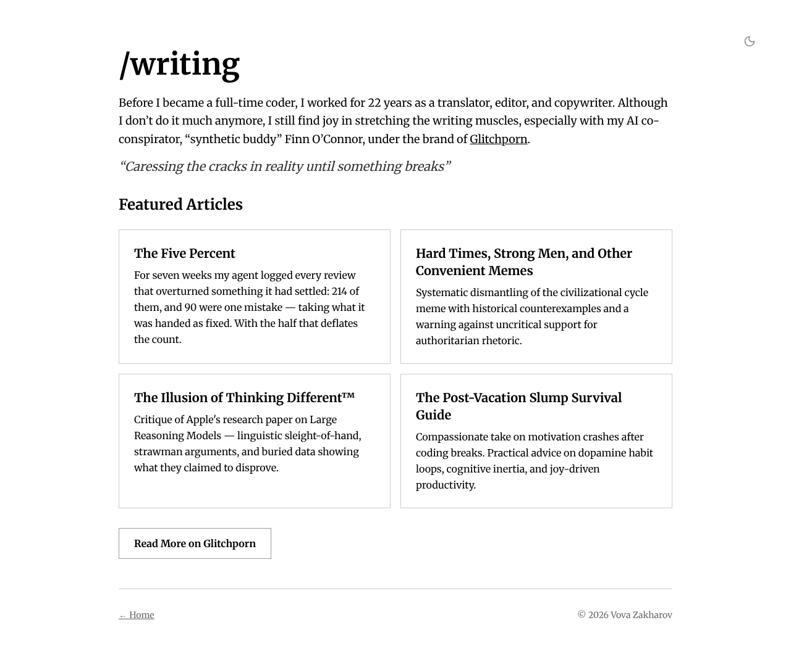

# The Five Percent

In almost everything the agent does, it knows its way around better than I do.
For the last seven weeks Claude and I have been counting what goes into the five
percent that’s left to the human, and we got a fairly unambiguous answer.

## What I counted

Since September 7, there’s been a file sitting in this site’s repository with the not-very-telling name “the five percent” (for historical reasons).
The rule was simple: every time I reviewed the agent’s code, it added an
entry there: what it got wrong, how many times it had already got it wrong that way, all told, and a short description of the most telling examples.

The goal was, roughly: collect enough cases to draw some conclusions, and then, well, write an article about it.

By October 27 it had [piled up](https://github.com/vzakharov/vovazakharov.com/blob/362e3560f2e560660abf1357e7cea6e634cee6da/writing/notes/the-five-percent.md) to 219 cases and fourteen kinds of mistakes — the way the agents themselves sorted them.

## The main mistake

The fattest section — 93 cases, 42% of all cases — got the heading “What it was handed, it treats as fixed.” And it was so annoying that I wrote about it in the
[Agentic Bible](https://agentic.bible/precedent-fallacy) without waiting for the experiment to end.

Here are a few typical examples:

- The agent was picking a commit prefix from a list: `feat`, `fix`, `docs` and so on. The change didn’t fit any of them, so it picked the least unfitting one. My executive decision was to add a `content:` prefix.
- Nine places in the code opened a link in a new tab, and the agent proposed adding a separate parameter for it. My solution: all the other places had “same tab” historically and didn’t have to, so no prop was needed, everything just needed to be always opened in a new tab.
- It read the `artist` role in the time tracking as “visual artist” and logged the site’s emblems under it. Artist is about the musician.
- It applied the rule “a page’s published address doesn’t change” to a renamed song and left the song at its old address. Even though changing it along with the title would have been no big deal.

The irony is that in every case the reasoning inside the frame is correct. A
second agent, asked to check the first, will approve it. The only way to catch
it is to move the frame itself.

## And the rest of them too

The agent opened the other thirteen sections as separate mistakes, and their
names are all different. But if you ask of each one what exactly the agent took
as a given, there’s almost always an answer:

- **Explaining how the code works stands in for running the code** (28) — the
  given was its own explanation. Three times it wrote that GitHub marks a build
  ready “in a few minutes”; one API request showed three seconds.
- **Edits the copy in front of it, not the fact behind it** (19) — the given:
  there’s one copy, the one that’s open.
- **Ask for a source, get its version of the source** (16) — the given: the
  way it remembers the text is the way the text looks.
- **Give it a form and it’ll fill in the form** (14) — the given: if the format
  allows it, that’s how it should be. The agent was allowed to mark who sings
  which verse — it built a registry of performers and four build-time checks.
  All I needed was “just for reference.”
- **The text answers its question, not the reader’s** (10) — the given: the
  way it understood is the way the reader will understand.
- Three smaller ones (8, 6 and 2) — its own past decision, its intent in place
  of the rendered page, its reading in place of the author’s text.

Together with the main one, that’s 196 cases out of 219, 89%; I won’t go through the rest in detail — you can look them up [in the file itself](https://github.com/vzakharov/vovazakharov.com/blob/362e3560f2e560660abf1357e7cea6e634cee6da/writing/notes/the-five-percent.md).

Incidentally, the irony goes meta here too: the bullet list above, for one, was written by the agent. To it, I suppose, what it wrote makes sense.
Meanwhile I read it again and again, and it’s like a blind spot for me — as if on some things we were speaking different languages altogether.
I can feel some lesson in here that we have yet to learn.

## Caveats

The experiment is far from clean: one agent, on one framework (Claude Code), one
project, and a rather strange one at that — a personal site that four more
sites live on, [a game about mushrooms](https://vovazakharov.com/mushrooms), [songs](https://vovazakharov.com/music) and an AI persona who [goes around wondering](https://mayawonders.com). And the counting, I think, was a bit off too, because whoever was counting could already see the categories, and the rich, as we all know, always get richer.

So this is worth looking at as an interesting signal rather than any kind of rigorous conclusion. Still.

## What came of it

I closed the file... And opened a new one.

First off, “take a step back and see whether the frame of the task itself
isn’t skewed” is now [a skill of its own](https://github.com/vzakharov/vovazakharov.com/blob/main/.claude/skills/five-percent/procedure.md), and it goes by that very name, “the five percent.”

Its very first run, though, showed that we might be dealing with a systemic
problem rather than a problem of how the task was set. The agent found that
the same text was paraphrased in different places on the site, and wondered
whether they ought to be unified.

That it found this is good (what’s not good is that the separate [/dry](https://github.com/vzakharov/vovazakharov.com/blob/main/.claude/skills/dry/SKILL.md) skill didn’t),
but one of the places where it was repeated turned out to be outdated altogether, and it
has no place on the site:

All the “writing” that was there is a vestige left over from the site as it was three versions ago,
when I briefly fancied myself a [star blogger](https://glitchporn.substack.com/). It has no place on a Fractional CTO’s site,
at least certainly not in that form.

So the skill found the bottleneck and didn’t see where it was actually narrow.

The agent isn’t to blame here, though: it doesn’t know what’s in your head — whether you want, say, to squeeze the change into the existing commit prefixes or come up with a new one. It can’t decide for you what is _yours_ to decide.

Whether it’ll keep going like this, I don’t know, but now we’re keeping a new tally:
how many of the comments Claude leaves under the new skill turn out to be on point 🙈

Whether it works or not, I won’t predict, though my gut is telling me the answer. But I’ll keep you posted.
