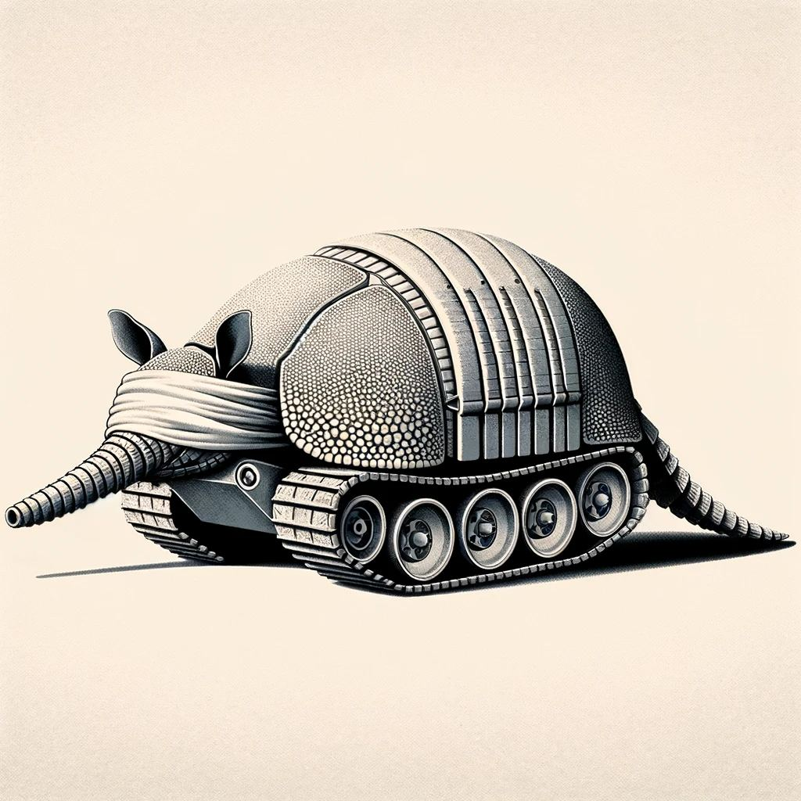
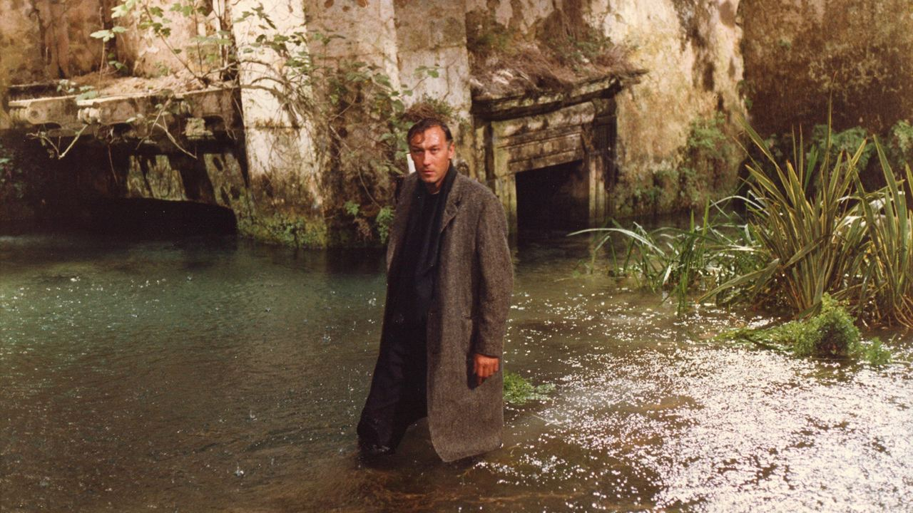

<!-- lang:ru -->

Первые опыты с Suno, как и многие, я ставил на стихах классиков. В какой-то момент возникла идея делать «альбомы», каждый на стихи какого-то одного поэта. На Тарковского выбор пал, скорее всего, из-за папиной любви, и даже не к самому поэту, а к его сыну-режиссёру («Ностальгия» была одним из его любимых фильмов).

Сначала альбом должен был называться «Таркос» — игра слов на «Tarkus» Emerson, Lake and Palmer, — тогда обложка могла выглядеть как-то так:

Но в конечном счёте это всё-таки стала «Ностальгия», с обложкой, вдохновлённой кадром из того самого фильма:

То, что название принадлежит не отцу, а сыну, незаметно для меня начало ту самую детско-родительскую нить, которая позже, уже после папиной смерти, вшилась в [Папу-реку](./father-river.md).

Так же «случайно» и сам выбор стихов для альбома, и их последовательность сложились в свою ностальгическую историю: собранные чемоданы и прощание с детством в «Приглашении в путешествие»; мысли об ушедшем — «будто и не бывало» — в «Лето прошло»; улетевшая «в Китай» безмятежная «Бабочка»; ужасающийся стареющему отражению «Актёр»; мучающая в ожидании «кредиторов», буквальных или фигуральных, «Бессонница»; «сгорание на пиру» в «Свече»; принятие с примесью колычёвского неповиновения в «Зиме в лесу».

Название «Полуживые», разумеется, тоже пришло из «Бессонницы» и легло идеально на всё: на «не совсем живую» ИИ-группу, на папино состояние и на моё тогдашнее — а может, и нынешнее — настроение.

<!-- lang:en -->

Like many people, I ran my first experiments with Suno on poems by the classics. At some point I had the idea of making “albums,” each on the poems of a single poet. The choice fell on Tarkovsky most likely because of Dad’s love — and not even for the poet himself so much as for his son, the director (_Nostalgia_ was one of his favourite films).

At first the album was going to be called “Tarkos,” a play on Emerson, Lake and Palmer’s _Tarkus_, and then the cover might have looked something like this:

But in the end it did become “Nostalgia,” with a cover inspired by a still from that very film:

That the title belongs not to the father but to the son started, without my noticing, the very thread between parents and children that later, after Dad’s death, was sewn into [Father River](./father-river.md).

Just as “by chance,” the choice of poems for the album and their order added up to a nostalgic story of their own: the packed suitcases and the farewell to childhood in “Invitation to a Journey”; thoughts of what is past — “as if it had never been” — in “Summer Has Gone”; the carefree “Butterfly,” flown off “to China”; “The Actor,” horrified by his ageing reflection; “Insomnia,” tormenting you as you wait for “creditors,” literal or figurative; “burning out at the feast” in “Candle”; acceptance with a dash of Kolychev’s defiance in “Winter in the Forest.”

The name The Half-Alive came, of course, from “Insomnia” too, and it fit everything perfectly: the “not quite alive” AI band, Dad’s condition, and my own mood at the time — and perhaps now as well.
