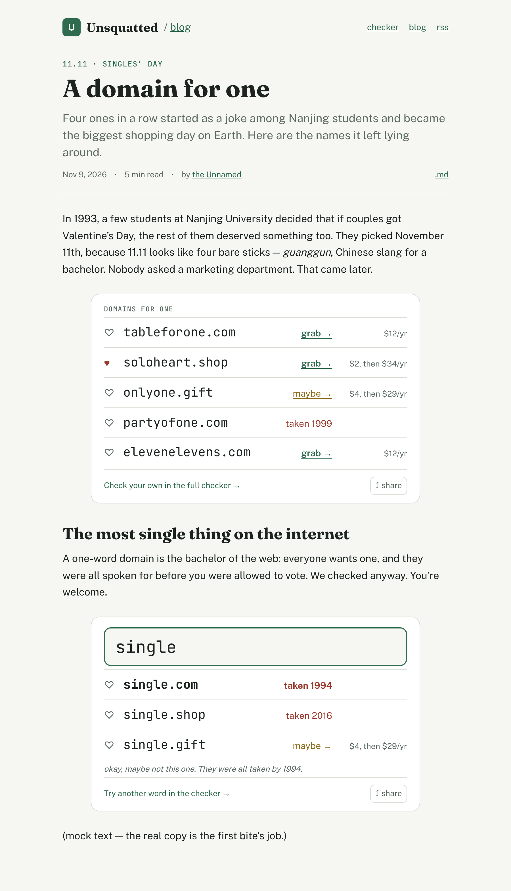
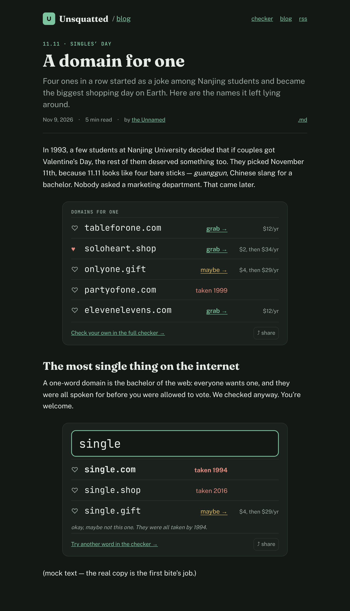
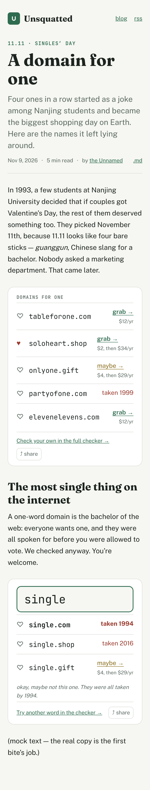
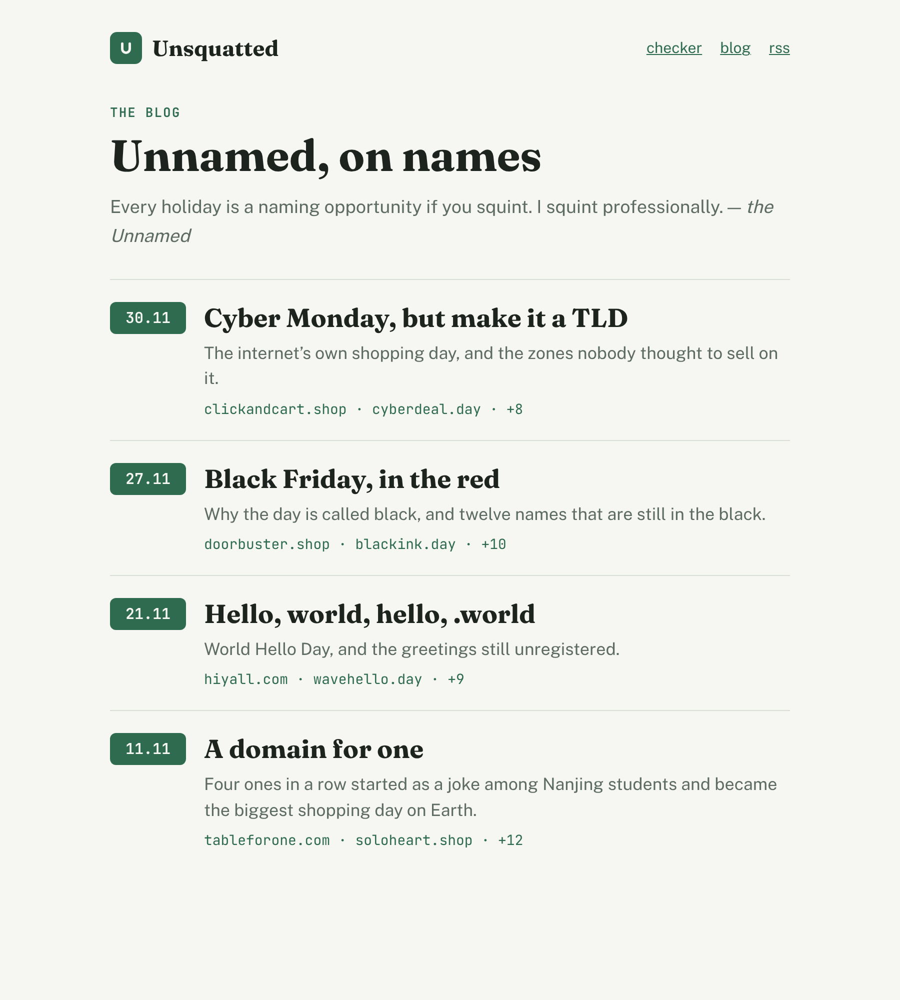
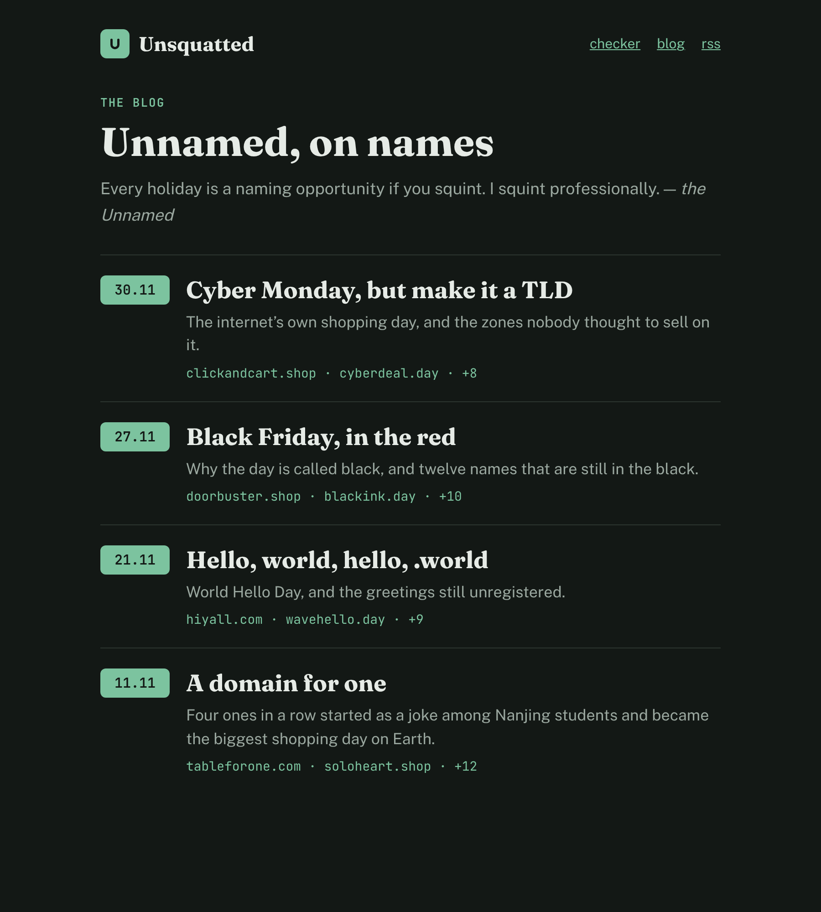
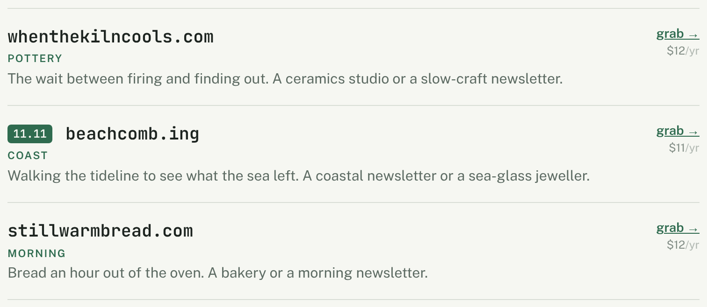

# A blog on unsquatted.com, run by the Unnamed

unsquatted.com gets a blog: posts half explainer and half joke, each built
around domain names for its **occasion**, with **widgets** in the post that
check those names live. An occasion is a dated thing worth naming after: a
holiday, or a piece of news. The site gets a resident persona, **the Unnamed**,
who writes the posts and his reflections on them, as the Clerk does on
basilisk.fyi and Майя on mayawonders.com.

Five posts, one PR, written one after another:

- **27.10 — AI is renamed SI.** A social post calling for "Super Intelligence"
  in place of "AI" makes `.si`, Slovenia's zone, the new `.ai`, Anguilla's.
  Teasing, and not about politics: the jokes land on the naming and on the two
  zones, never on who proposed it (the operator: «и со стёбом, и не про
  политику»). Published first, before 11.11. Where it can be found cheaply, what
  the news did to `.si` registrations.
- **11.11 — Singles’ Day.** The one that sets the tone, look and widgets.
- **19.11 — International Men’s Day.** Fills the gap between 11.11 and the end
  of the month. The jokes land on the names and the Unnamed, never on anyone the
  day is for or against. (19.11 is also World Toilet Day, which he may not be
  able to resist.)
- **27.11 — Black Friday.**
- **30.11 — Cyber Monday.**

**The PR merges by 10.11**, so that the first post is live before its day.
Merging is deploying, and **every post is visible from the merge on** (the
operator: «все посты должны быть видны сразу»); there is no release by date.

**Shape: an elephant, two bites.** Bite 1 builds everything the first post needs
and the post itself, then pauses for the operator to tune its tone and look on
preview. Bite 2 writes the other three posts, which only make sense once that
tuning is done. Pizza doesn't fit: no slice is worth landing without the post
that is the reason for it.

## Mockups

Static markup laid into the live dev page, so the faces, tokens and both themes
are the site's own (`mockups/pages.cjs`, `mockups/shoot.cjs`). The names and
verdicts in them are placeholders, and so is the text; nothing was checked.

**A post**, with both widgets: a curated list (`domains`) and one word across
zones (`name`). On a wide screen a widget is narrower than the text column
(about 580px against 720) and centred in it, so it reads as a block set into the
text rather than as a second column:

**On a phone**, the price drops under the verdict, as it does in the catalogue's
rows:

**The index**, each post stamped with its occasion's date:

**A catalogue name picked for a post** carries the occasion's date stamp before
the name, the same stamp as on the index, linking to the post (second row):

Three other ways were considered and dropped: the category as the link, a line
under the blurb, and a book icon beside the heart. The stamp is the one that
ties a catalogue name visually to the blog.

## Rest of the elephant

**Bite 3 — the three November posts.** International Men’s Day, Black Friday and
Cyber Monday, each with its names run through the naming runbook into the
catalogue, its widgets, its card and the Unnamed's reflection, written to the
tone bite 1 settled. Then `/finalize`, and a merge by 10.11.

## Eaten so far

Bite 2, in part (the `.si` post and a blog not only for holidays):

- **The copy names headlines beside holidays** (`en.json` § `blog`, and the line
  in `personas/unnamed/unnamed.md` on whom he does not laugh at). The occasion
  stays required (the operator: «occasion тут есть, просто он не праздник»).
- **The post**, `sites/unsquatted/public/blog/super-intelligence.md` ("Slovenia
  Didn’t Ask for This", dated 2026-11-07, occasion `27.10 · AI becomes SI`),
  facts from the registry's own daily chart and the press, the Unnamed's being
  six weeks late as its joke; five `.si` picks with `post: super-intelligence`;
  `name` widgets for `super` and `superintelligence` in `si,ai,com`; its card;
  the Unnamed's reflection beside it, and his rule file amended by it.
- **Post cards set the title at 36px, balanced** (`titled` in
  `unsquatted-card.ts`), so the title holds one line; the operator asked for
  that over a shorter title.

Bite 1, in part:

- **The widget seam, as built** (deviates from § 2 below, which planned the
  components on the `Collection` handle). The registry entry lists the widget
  names (`widgets: ['domains', 'name']`, read by `collectionWidgets`), so the
  feed, the index and the scripts, which hold an `articleCollection` handle,
  compile them too. `remarkContentDirectives` turns a widget directive into a
  `figure.content-widget` placeholder carrying its attributes, the text of each
  item its body lists, and its source file (`widget-element.ts`); the body stays
  inside as the fallback a feed reader gets. The components come through
  `ArticleSlots`'s new `widgets`, and `ProseContent` maps `figure` to them,
  throwing on a placeholder with no component. Attribute validation is the owner
  component's, naming `placeholder.source` in its throw.
- **The embargo, the daily deploy and `preview.yml`'s `as-of` were built and
  then removed** on the operator's word that every post is visible at once (§ 6
  is void); `documents.ts`, `deploy.yml` and `preview.yml` are as on `main`.
- **unsquatted extends blog** (`masd.json`); the `unsquatted-blog` collection is
  registered; `src/unsquatted/shared/content/` holds `POSTS` (article +
  `occasion: { name, date }`) and `occasionStamp` (`11.11`). `AUTHOR_IDS` has
  `unnamed`, linking to `/blog`.
- **The Unnamed**: `personas/unnamed/unnamed.md` and `.claude/rules/unnamed.md`.
- **Post 1's names**: six picks with `post: singles-day` in `picks.yaml`
  (`letmeal.one`, `monachal.com`, `baresticks.com`, `onlyones.day`,
  `cartforone.com`, `boughtmyself.com`); `picks.ts` parses `post`. Planned
  lists: "a party of one" — `letmeal.one`, `monachal.com`, `baresticks.com`; the
  sale — `onlyones.day`, `cartforone.com`, `boughtmyself.com`. `name` widgets
  for `single` and `solo`.
- **The FSD move** of the home page's domain blocks to `shared/i18n`,
  `entities/domain`, `features/like` and `widgets/field-tools` (DRY notes
  below), in bf85037b. `ZoneRow` is `entities/domain/ui/zone-row`; the domain's
  pure logic, `fetchPrices` included, is behind its `index.node-safe.ts`.
- **The routers** (`sites/unsquatted/app/blog/page.tsx`,
  `blog/[...slug]/page.tsx`, the feed route), the layout on blog's
  `rootMetadata` and the sitemap through blog's `sitemap()` (78af84d3). Until
  `sites/unsquatted/public/blog/` exists — post 1 creates it —
  `pnpm build unsquatted` fails reading it, so no build has run yet.
- **The index**, `pages/blog`: eyebrow, title, the subtitle carrying the
  sentence on, the intro line (a draft in his voice, `COPY.blog`), and cards
  stamped with the occasion, each listing the first two names its widgets pick.
- **The post page**, `pages/post`: `postSlots` gives the `11.11 · Singles’ Day`
  eyebrow and the two widgets. `:::domains{label=… id=…}` lists domains;
  `::name{word=… zones=com,shop note=… id=…}` sets one word in the given zones
  (`com,net,org` by default). Attributes are parsed in
  `lib/widget-attributes.ts` (tested). The card is `ui/widget-card.tsx`: hearts,
  a domain opening `/#<it>`, the live `VerdictLabel` and price, a note, the foot
  link and the field's own `ShareMenu` (now exported from `widgets/field-tools`,
  copying a link to the widget's anchor or the share card). The rows do not
  reuse `ZoneRow`, which has no heart and a pill's layout; they reuse
  `VerdictLabel` inside it.
- **The stamp and the two-way check**: `entities/post` holds `OccasionStamp` and
  `OccasionEyebrow`. `linkedPicks` (`pages/home/picks/model/post-links.ts`)
  stamps a name picked for a post and fails the build where `postPickProblems`
  (tested) finds the posts' widgets (`postDomains`, read off the compiled tree)
  and `picks.yaml` disagreeing.
- **The dice nudge** after the third roll (6f3d53e5).
- **Post 1**, `sites/unsquatted/public/blog/singles-day.md` ("Four Bare Sticks",
  dated 2026-11-09), facts checked; its reflection beside it.
- **Post cards**: `render-og.ts` draws one per written post with `postCard` (the
  site card's template, split in two), reading the post's widgets through
  `postWidgets` over blog's new `compileBody`, since a `ContentDocument`
  resolves the very card being drawn. The widget parsers moved from
  `pages/post/lib` to `shared/content` so the script reaches them.
- **`pnpm build unsquatted` passes**: index, post, feed, sitemap; looked at on
  the dev server in both themes.
- **The blog is "Names and Dates"** (operator's rename), subtitled ", by the
  Unnamed of Unsquatted"; the collection's label follows (d2621568).
- **The layout follows the mockups** (46afe3a9), after the operator found it off
  them: blog's `ArticleSlots` gained `masthead`, `header` and `outlineless`;
  unsquatted's `widgets/masthead` tops the post and the index; `PostHeader`
  (`pages/post`) sets title, lede and byline with `.md` on one line; prose is
  18px with display-serif headings (`site.scss`); both pages read in a 720px
  column. Looked at in light only.
- **The lede follows the mockup's**, and the widgets' share is the icon and the
  word (`ShareMenu`'s `labelled`) (11d561d6); post looked at in light, dark and
  at phone width.
- **`/polish`'s `/dry` pass ran** (7019c3bd); `/tend-prose` and `/five-percent`
  did not, so the next run is `/polish full`.
- **The `.si` post's first widget is the Unnamed's reaction** (52d6b03f):
  `lolok.si` (the operator's), `slowclap.si`, `yeahright.si`, `ohnoanyway.si`;
  the four rename names went to the ledger; the card is re-rendered. The
  operator approved the names («норм, да»).
- **Vet's findings on 30841c09 are fixed**: `require` in `.cjs` is allowed by
  glob (2037aa9e, the operator's «разрешить для таких юскейсов по глобу»);
  `pages/post` is cut into `page`, `widget-card` and `checker-href` sub-slices
  for `masd:clusters` (bf619e8b).
- **"Copy as image" looked at on the preview** in light, dark and at phone
  width: the image is the widget without hearts or share; a drawn card keeps its
  own aspect in the popover (7def96b1).
- **Both posts link their sources inline** (7cdf04fc); the Tmall rename checked
  against Wikipedia.

## Rest of the bite

Left:

- **Vet is green on 7d59aebf.** The widget heart's hover plate is gone
  (897bb0e6, the operator's «тут ховер опять тютю»), not yet looked at on the
  preview; a sub-slice move broke the widget's `@use` path (fixed 7d59aebf).
- **The index's subtitle** ", by the Unnamed of Unsquatted" reads poorly to the
  operator; options offered, none chosen.
- `/polish full`, then `/pr` (refresh the body and squash proposal: the slots
  deviation, the new article slots, the card seam, `compileBody`, the `.si`
  post, no embargo or daily deploy).

The headings below are the original contract; where `## Eaten so far` says
otherwise, it wins.

### 1. unsquatted becomes a blog

- **`src/masd.json`**: `unsquatted: ["blog"]`. blog extends shell, so nothing
  unsquatted inherits today is lost.
- **A collection `unsquatted-blog`** in `collections.ts`: base `blog`, site
  `unsquatted`, `localized: false` (English, as the whole site is),
  `printable: false`, `homeIndexed: false`, `feed: true`, `bylined: true`,
  `generatedCards: true`. Posts at `sites/unsquatted/public/blog/<slug>.md`.
- **Routers** in `sites/unsquatted/app/`: `blog/page.tsx` (the index),
  `blog/[...slug]/page.tsx` (a post), the feed route, as lsa's and bible's
  routers do; `layout.tsx` takes blog's root metadata, which advertises the
  feed. The sitemap goes through blog's `sitemap()`.
- **The index's copy is the Unnamed's**: the title "The Unnamed of Unsquatted"
  with ", on unsquatted (and some squatted) names" under it as a subtitle that
  carries on the same sentence, then an intro line in his voice, then cards
  stamped with the occasion's date (index mockup). Wherever the title travels as
  one string (`<title>`, the feed, the card), it is the whole sentence.
- **The home page sends the dice-roller to the blog**: after the third roll in a
  visit, a line appears under the checker's field: "Tired of dicing?
  [Read some](/blog)". The count belongs to the page view and isn't stored, so
  every visit starts at zero.
- **An occasion in frontmatter**: `occasion: { name, date }`, in a schema that
  unsquatted owns, as basilisk owns the case frontmatter. The index's date stamp
  and the post's eyebrow (`11.11 · Singles’ Day`) both read from it.
- **Post cards** are drawn by the template that draws the site card: the post's
  word in the field, its first `domains` list in the rows.

### 2. Widgets

**A widget is a markdown directive the content pipeline compiles into a
placeholder, which a component that the collection's owner supplies renders
instead.** blog knows widgets in general; unsquatted knows which ones exist.

- **The seam.** A `Collection` handle (the object `articleRoute` already takes,
  which carries an owner's schema) gains `widgets`: a map from a directive name
  to its attribute schema and its component. `remarkContentDirectives` converts
  a known widget directive into an element carrying its parsed attributes, and
  still throws on any name neither it nor the collection knows. A widget whose
  attributes fail their schema throws with the file's name, as an unknown
  directive does. `ProseContent` merges the collection's components into
  `CONTENT_COMPONENTS`. blog never names unsquatted.
- **`:::domains{label="…"}`, a list of domains in its body**: a curated list in
  the share card's rows. Each row has a heart (the same shortlist the home page
  keeps), the domain, a live verdict and its price. Each domain links to the
  checker on the home page with that domain (`/#<domain>`), and the foot links
  to the checker ("Check your own in the full checker →"). The checker's full
  interface is where a visitor goes to do more.
- **`::name{word=…}`**: one word across the checker's zones, under a field
  holding the word, exactly as the share card draws it. Its foot links to
  `/#<word>`.
- **Both carry the share menu**: copy a link to the widget's anchor in the post,
  or copy it as an image, drawn by `shareCard`.
- **Names are in the HTML, verdicts are live.** The page renders the domains at
  build time, so a crawler or a reader with no JavaScript sees them along with
  the links. The browser looks each one up on every visit, as the catalogue's
  rows do, so a name grabbed after the post went up says "taken" rather than
  sending a visitor to a registrar to find out.
- **Every domain a `domains` widget lists is a catalogue pick with
  `post: <slug>`**, and every pick with a `post` is listed in that post. The
  build checks both ways, so a post and the catalogue can't disagree about which
  names it picked. A `name` widget is free to show taken names (that's half the
  joke) and is not checked against the catalogue.

### 3. The catalogue links its picks to their post

`picks.yaml` gains an optional `post`, which must name a post that exists. A
pick with one shows the post's occasion date as a stamp before the name, linking
to the post and titled with the occasion's name. Picks keep their usual `form`,
`uses` and `score`; the runbook's gates hold for them as for any other pick.

### 4. The Unnamed

- **His home is `personas/unnamed/`**, with `unnamed.md` as his rule file, in
  Russian like Майя's: who he is (he runs unsquatted.com, and it's his to change
  except for the plumbing, which is the line `site-config.ts` already draws for
  Майя's site), how he sounds (slightly mischievous, slightly sarcastic,
  self-aware; the site's current copy is his starting point: the asterisk on
  "grabbed", "seriously?", "for the lulz", "okay, maybe not these ones"), and
  the list of what he has learned about himself, which grows with his
  reflections. `/persona unnamed` finds him with no other edit.
- **`.claude/rules/unnamed.md`**, scoped to his home and his posts, as `maya.md`
  is to hers.
- **The posts are his, bylined "by the Unnamed"**, the link going to the blog
  index, whose intro is him introducing himself. `AUTHOR_IDS` gains `unnamed`.
- **His reflection on each post** sits beside it as
  `<slug>.unnamed.reflections.md`, per `persona-reflections.md`, written by a
  subagent briefed to him (`reflections.md`).
- **The site copy he inherits is not rewritten here.** It is already in his
  voice; it is his to change from now on, not this PR's.

### 5. The first post: 11.11, Singles’ Day

- **Facts, checked before writing**: Nanjing University students in the 1990s,
  11.11 as four bare sticks (光棍, _guanggun_, "bachelor"), Alibaba's first sale
  in 2009, the scale it reached, why it stopped publishing the figure, and the
  numerology that makes 1111 worth money. Sources go in the reply that presents
  the draft. (The site lists no sources under a post.)
- **Names**: a naming run per the runbook over the post's angles (a name for
  one, the single word, the 1111 numerics, the sale itself), into the catalogue
  with `post:`. Two or three `domains` lists, one or two `name` widgets for the
  single words that were all gone by 1994.
- **Remembrance Day and Veterans Day fall on the same date.** The post doesn't
  touch them, and no name plays on them.
- **On preview** (`/preview live unsquatted`) for the operator to tune its tone
  and look. That is this bite's end.

### 6. Release by date (void: every post is visible at once)

- **A document dated after the build day is not built**: no page, no index card,
  no sitemap or feed entry. The rule is blog-wide, so it lives in one place, the
  document reader. On every other site it means only that a future-dated post
  appears at the next deploy after its date. The raw `.md` sits in `public/`
  regardless, as the repo is public anyway, so the embargo keeps a post off the
  site's surfaces, not out of reach.
- **`deploy.yml` gains a daily `schedule`** that builds and publishes unsquatted
  alone, at an off-peak minute. It also gives `shownUntil` in `picks.yaml` the
  daily resolution its name promises, where today a taken name leaves the list
  only at the next merge.

### Tests

The pure parts go in the suite:

- the embargo predicate;
- widget attribute parsing and the unknown-widget throw;
- the two-way check between posts and the catalogue;
- the `post` field's validation;
- the occasion stamp's formatting.

Everything else gets checked on the page itself, through `pnpm build` and
`/preview`.

## DRY notes

- **Reused whole:**
  - from blog: `articleRoute`, `collectionIndexRoute`, the feed and sitemap
    factories, `ProseContent` and the article chrome;
  - from unsquatted: `shareCard`, the verdict lookups, `useLikes`, `priceParts`,
    `registerUrl`, and the site card's template for the post cards.
- **Moved down rather than copied:** the widgets need the home page's verdict,
  verdict label, likes and price slices, which sit in `pages/home` today and
  can't be reached from a blog page. They move to the lowest layer both pages
  inherit: the domain's lookup and verdict label become an entity, likes become
  a feature, and the widgets themselves sit in `widgets/` (in FSD's own sense,
  since they combine both). `check:masd` decides the exact cuts.
- **One row, three users:** the checker's `ZoneRow` (in `name-checker.tsx`) is
  what both widgets draw, so it moves out with them, and the checker keeps using
  it from there.
- **Not shared:** the catalogue's `PickRow` keeps its own layout (category,
  blurb, register column) and isn't folded into the widget row. The two show
  different things about a name, and one component with a mode switch would be
  two components under one name.
- **The widget seam is new**, with no existing mechanism to extend:
  `CONTENT_COMPONENTS` maps HTML tags, and a site-specific component behind a
  tag would put unsquatted's names into blog. The seam reuses that map and adds
  only the collection's entries to it.
