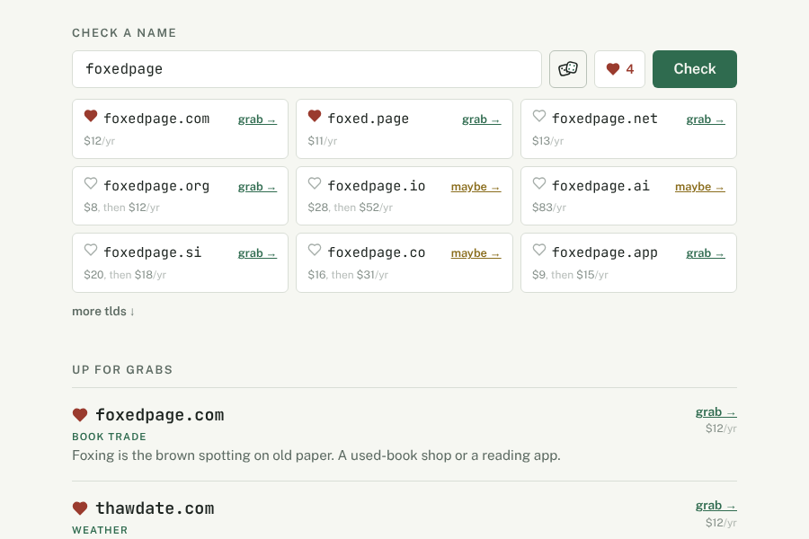
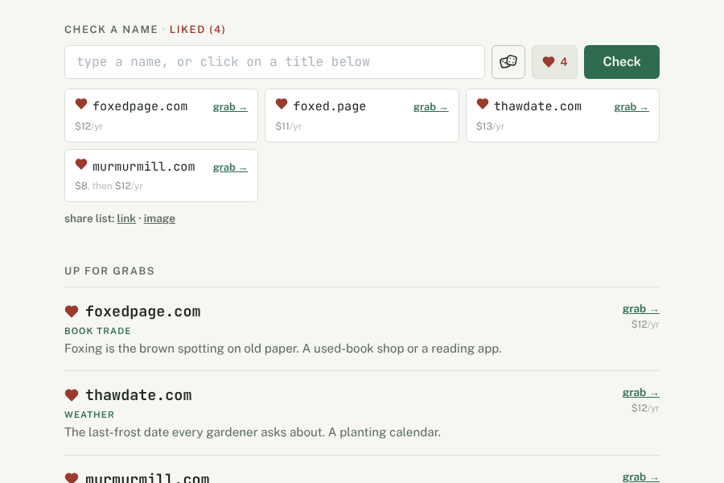
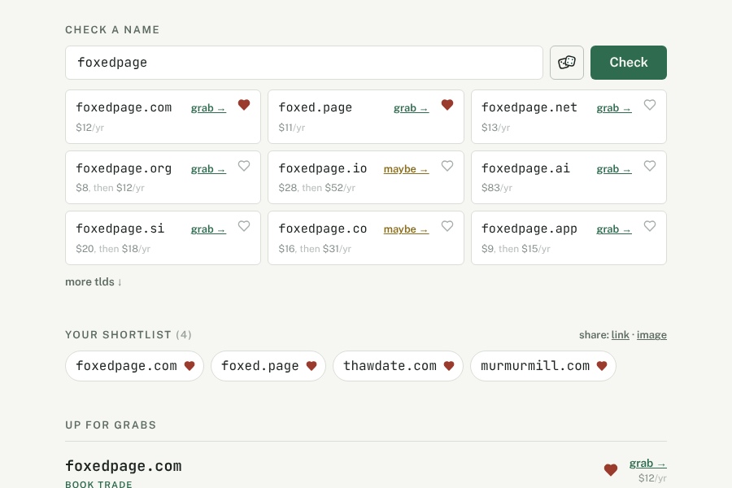
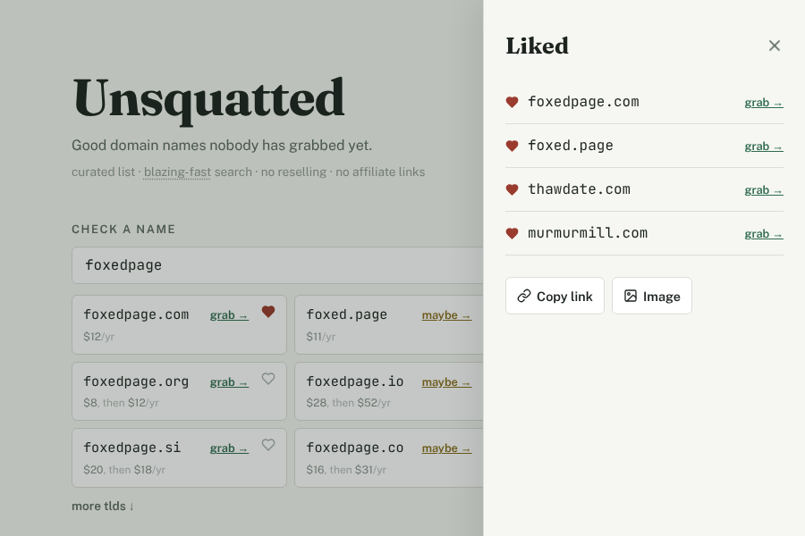
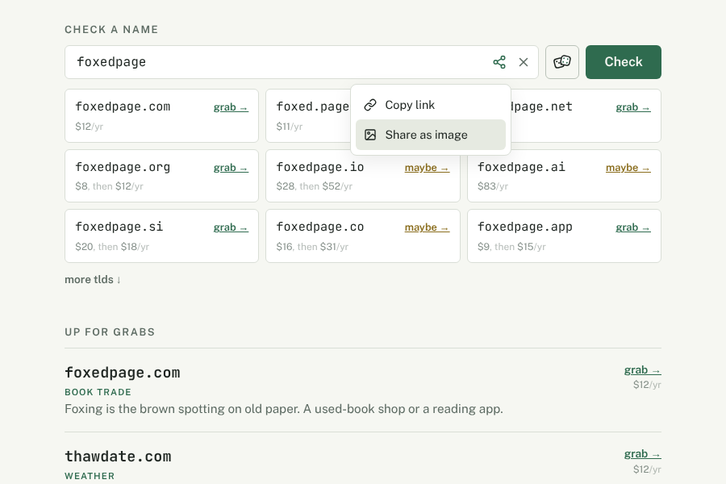
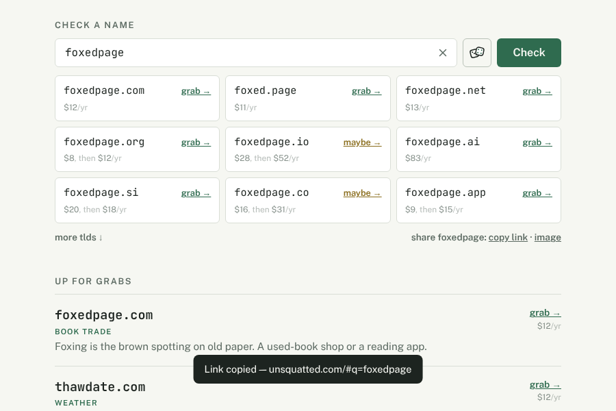
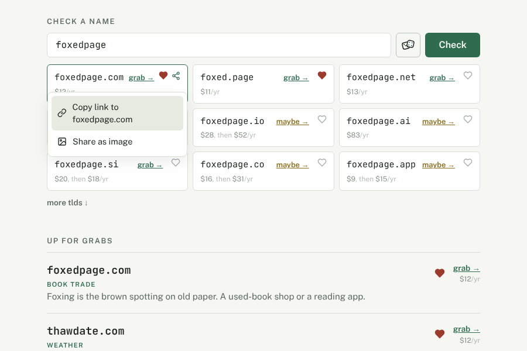
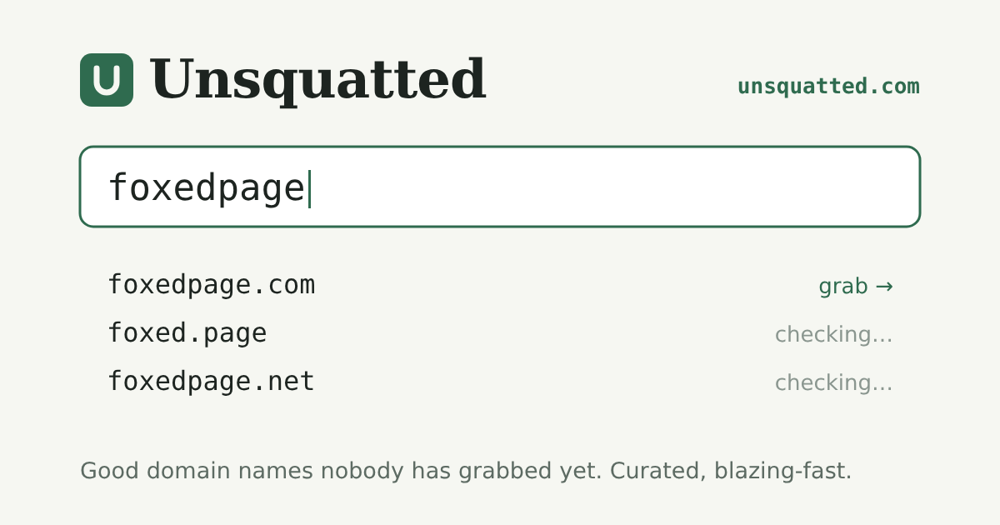
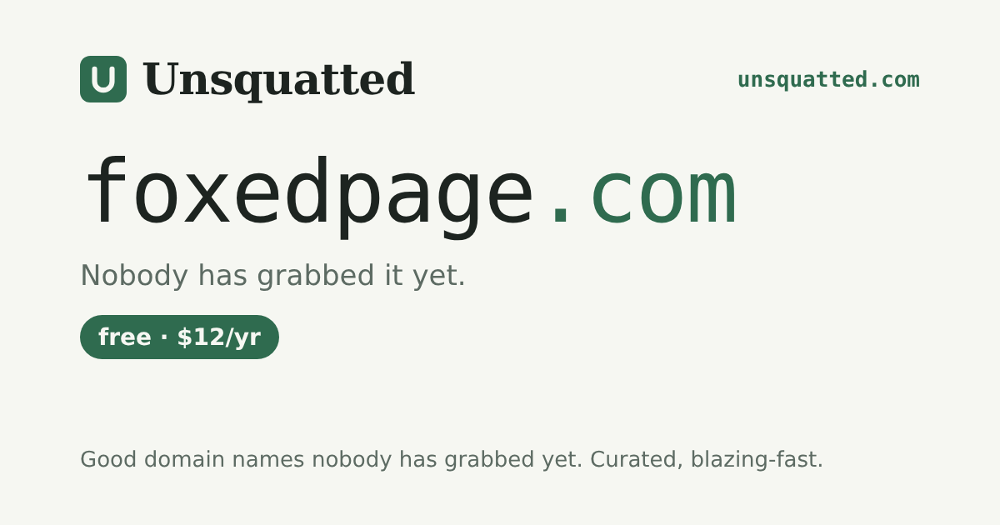
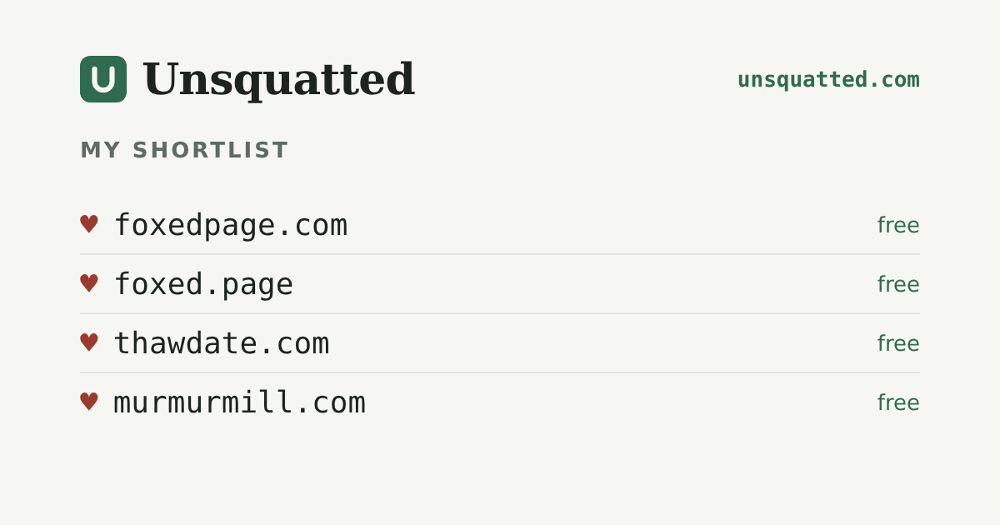

> ⛔ **DRAFT — DO NOT IMPLEMENT.** This plan is not approved. Do not edit source
> while this file is named `*.draft.do-not-implement.md` — prep and spikes go in
> `tmp/`. On an explicit operator go-ahead, `git mv` it to `*.in-progress.md`
> and delete this banner (quoting the go-ahead in the commit) _before_ touching
> code.

# unsquatted: `#q=`, a clean address, focus, clear, likes and sharing

Six changes to unsquatted.com's checker, asked for in one message:

1. the name in the address becomes `#q=<name>`, so other parameters fit beside
   it;
2. the address stops carrying the name;
3. the field is focused on arrival;
4. a × at the field's right end clears it;
5. a heart on any name, and a view of the liked ones at a hash parameter;
6. sharing a name as a link (copied to the clipboard) and as an image.

The operator picks the design for 5 and 6 from the mockups below. Every fork
carries a recommendation, and the plan is written with the recommendations in
force.

## The address (1, 2)

The hash becomes a query string, read with `URLSearchParams`: `#q=foxedpage` for
a name and `#liked` for the liked view (`#liked=a.com,b.io` for a shared list, §
5). A bare `#foxedpage`, the form links in the wild carry today, is still read
as `q`.

**The address is input only: a link is read on arrival, looked up, and then
removed** with `history.replaceState`. Typing no longer writes the name into the
address or pushes a history entry, so the address bar stays `unsquatted.com` and
Back leaves the site rather than walking through every name tried. A link to a
name is made on purpose, by Share (§ 6). The cost: a reload forgets the name.

`hashchange` stays wired, so a `#q=` pasted into the address bar of an open tab
is looked up, then removed the same way.

## Focus on arrival (3)

`fieldRef.current?.focus()` once on mount. On a touch screen (`pointer: coarse`)
it is skipped: focusing there raises the keyboard over the page the visitor has
not yet seen (iOS ignores a programmatic focus anyway, Android does not).

## Clear (4)

A `CloseButton` in the `TextInput`'s `rightSection`, shown while the field holds
text. It empties the field and the lookup at once (no settle delay), and leaves
the focus in the field.

## Likes (5)

Liked domains are full domains (`foxedpage.com`, not `foxedpage`), kept in
`localStorage` under one key through Mantine's `useLocalStorage`, which also
syncs across open tabs. A likes context sits beside `CheckerProvider`, since the
checker's cards, the picks and the liked view all read and toggle the same set.

When `localStorage` throws (Safari private mode, blocked site data), likes live
in memory for the visit, and the counter's tooltip says they will not be kept.
This is a degradation the visitor is told about, not a silent fallback.

### Variants

**A — counter beside the dice, liked view in place of the results**
(recommended). A heart before each name in the result cards and the picks. A
heart-and-count button joins the field row; pressing it, or arriving on
`#liked`, swaps the results grid for the liked names, as the same cards with
live verdicts and prices, and the heading reads "Check a name · liked (4)".
Typing returns to the results. It reuses the result grid and its lookups whole,
and puts no new block on the page.

**B — a shortlist section.** The heart sits at the card's right edge. Once
anything is liked, a "Your shortlist (4)" section appears between the checker
and "Up for grabs", the names as chips; `#liked` scrolls to it. Always visible,
but it pushes the curated list down for every returning visitor, and the chips
show no verdicts.

**C — a drawer.** A heart counter in the page's corner beside the theme toggle
opens a side drawer of liked names; `#liked` opens it. Keeps the page as is, but
the counter sits in the layout's corner, which `shell` owns for every site, and
Mantine's `Drawer` adds a component sheet.

## Share (6)

**A link** is `https://unsquatted.com/#q=<name>` (the zone kept when one was
typed), written with `navigator.clipboard.writeText`. The control's own label
turns into "copied ✓" for two seconds; the site has no toast system, and adding
`@mantine/notifications` for one message is not worth it. In the liked view the
link carries the list: `#liked=foxedpage.com,foxed.page`. Opening that shows the
shared list, headed "shared list", its hearts showing the reader's own likes, so
liking one adds it to theirs.

**An image** is drawn in the browser on a 1200×630 `<canvas>` with the fonts the
page has already loaded, its colours read from the page's `--color-*` tokens, so
it follows the light palette with no colour literal in the component. Where
`navigator.canShare({ files })` holds (phones, Safari, Chrome on Windows and
Android) the PNG goes to the system share sheet; elsewhere it downloads as
`unsquatted.<name>.png`.

### Where the controls sit

**A — inside the field.** A share icon beside the ×, opening a two-item menu.
Compact, but sharing is hidden behind an unlabelled icon and a menu.

**B — a line under the results** (recommended). "share foxedpage: copy link ·
image" on the "more tlds ↓" line, in the same muted text-button style. Always
visible once there is something to share, and costs no menu. The liked view
carries the same line for the list (see 5A's second screenshot).

**C — per card.** A share icon on each result card, sharing that one domain. The
most precise, but a card already holds a name, a verdict, a price and a heart,
and the fifth item crowds it (see the first card).

### What the image shows

**1 — the search** (recommended with 6B). The existing mock in
`src/unsquatted/scripts/lib/share-card.mock.svg`: the name in a field, its first
three zones with their verdicts as they stand when shared. It is what 6B shares:
a query and what it found.

**2 — one domain.** The domain large, "Nobody has grabbed it yet", its price.
The strongest card on its own, but it needs one domain, which fits 6C, not a
query.

**3 — the liked list.** Up to five liked domains with their verdicts, "+ N more"
past that. Used for the list whichever of 1 or 2 is picked for a name.

## Files

All inside `src/unsquatted/pages/home/page/`, as sub-slices where
`pnpm check:masd` and `pnpm masd:clusters` earn them (likely `likes/` and
`share/`):

- `lib/address.ts` + test: parsing `#q=` / `#liked[=…]` / the bare legacy form,
  and building share links.
- `ui/checker-state.tsx`: reads the address through `address.ts`, removes it,
  stops writing it; `clear()`.
- `ui/name-checker.tsx`: focus on mount, the × in `rightSection`, the counter,
  the liked view, the share line.
- likes: the context and storage hook, `HeartButton`.
- share: `copyLink`, the canvas renderer (`drawShareCard`) and `shareImage`.
- `ui/pick-row.tsx`: the heart.
- `config/messages/en.json`: the new copy.
- `share-card.mock.svg` is deleted once the real card exists, since its own
  comment says it is a mock rendered nowhere.

## DRY notes

- **One parser for the address.** Arrival, `hashchange` and the share links all
  go through `address.ts`, so `#q=` is spelled in one place.
- **The liked view reuses `ZoneRow` and `useVerdicts`** rather than a list of
  its own, so a liked name shows exactly what a looked-up one does.
- **One `HeartButton`** for result cards, picks and the liked view.
- **The image card does not share code with the social card**
  (`unsquatted-card.ts`). That one is HTML rendered by Playwright at build time,
  this one is a canvas drawn at runtime: a common layout abstraction would need
  two renderers behind it to save a few coordinates. They share the colours
  through the tokens on the live page and the script's own constants, as today.
- **Verdict wording comes from `COPY.verdict`**, the copy the cards use.

## Tests

- `address.test.ts`: `#q=`, legacy `#name`, `#liked`, `#liked=a,b`, encoding of
  a typed zone, round trip of a share link.
- The liked set's serialisation (dedupe, order kept).
- The card's text layout (which rows fit, "+ N more") as a pure function beside
  the drawing.
- The rest by `/preview`: focus, the ×, hearts, the liked view, copy and image
  in both themes and at phone width.

Squash subject: `feat(unsquatted): …`, publishing unsquatted.com alone.
