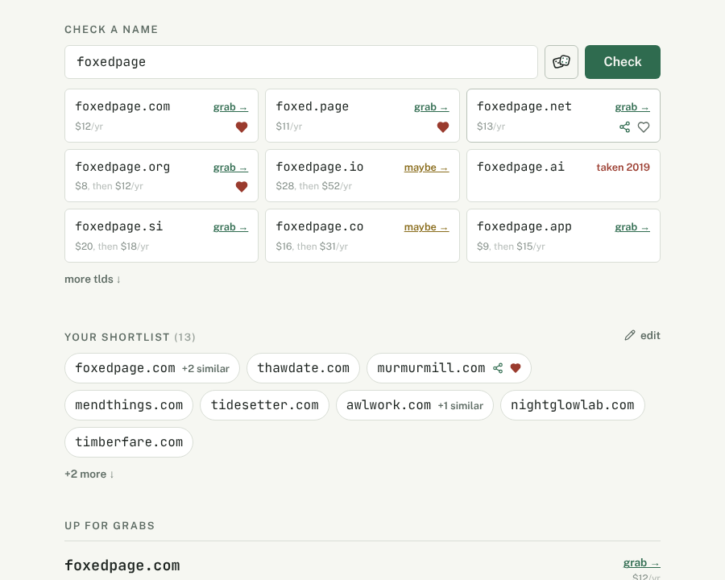
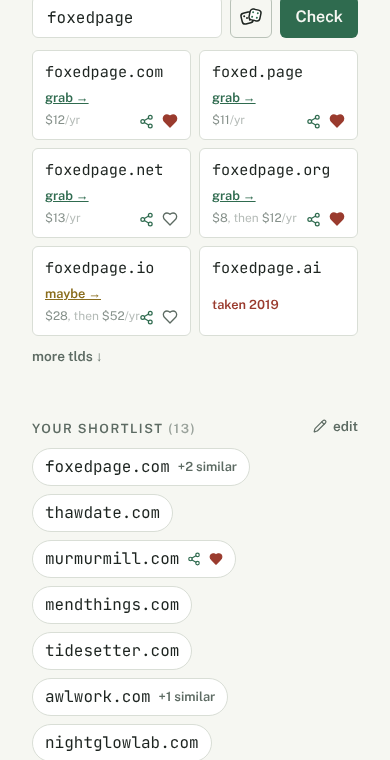
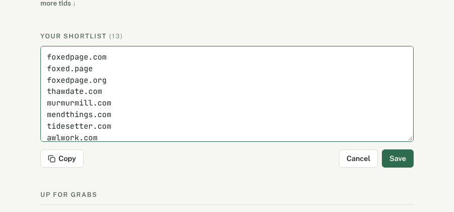
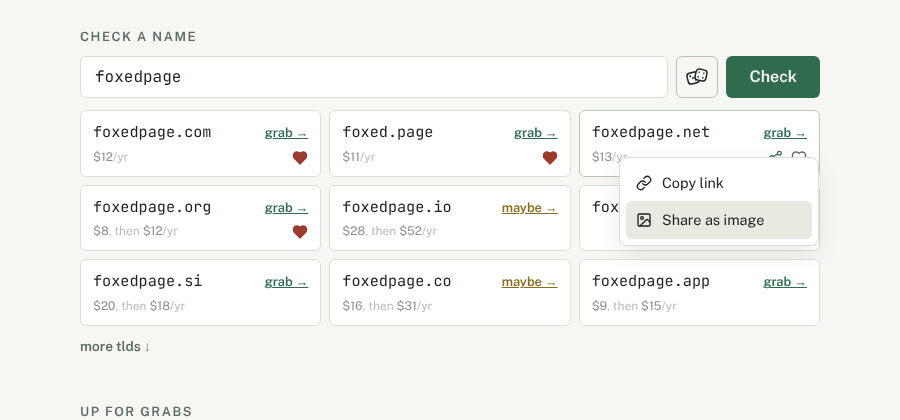
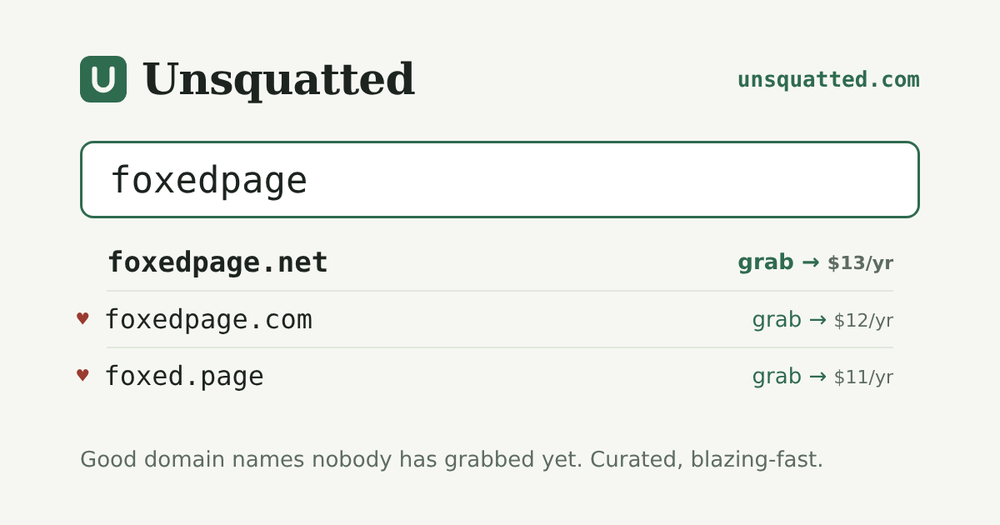

# unsquatted: a clean address, focus, clear, a shortlist and sharing

Changes to unsquatted.com's checker:

1. the address stops carrying the name once a link is read;
2. the field is focused on arrival;
3. a × at the field's right end clears it;
4. a heart on any available name, and a shortlist of the liked ones, edited as
   plain text;
5. sharing one available name as a link (copied to the clipboard) or as an
   image.

## The address (1)

The hash keeps its form: `#foxedpage`, or `#foxedpage.net` for one domain, whose
zone the checker shows first.

**The address is input only: a link is read on arrival, looked up, and then
removed** with `history.replaceState`. Typing no longer writes the name into the
address or pushes a history entry, so the address bar stays `unsquatted.com` and
Back leaves the site rather than walking through every name tried. A link to a
name is made on purpose, by Share (§ 5). The cost: a reload forgets the name.

`hashchange` stays wired, so a hash pasted into the address bar of an open tab
is looked up, then removed the same way.

Rejected at review: a `#q=` / `#liked` scheme, which only a separate liked view
needed, and that view itself; a drawer for likes; share controls in the field or
under the results; sharing the whole shortlist; a one-domain hero card.

## Focus on arrival (2)

`fieldRef.current?.focus()` once on mount. On a touch screen (`pointer: coarse`)
it is skipped: focusing there raises the keyboard over the page the visitor has
not yet seen (iOS ignores a programmatic focus anyway, Android does not).

## Clear (3)

A `CloseButton` in the `TextInput`'s `rightSection`, shown while the field holds
text. It empties the field and the lookup at once (no settle delay), and leaves
the focus in the field.

## Likes and the shortlist (4)

### Hearts

A heart sits in the bottom-right corner of each result card, on the price line,
which has the room the name line lacks, and beside the register link of each
listed pick. **Only a name that is free or maybe gets one**: a taken name, or
one still being looked up, has neither heart nor share.

- **Liked**: the filled heart always shows.
- **Not liked, on a device with hover** (`@media (hover: hover)`): the empty
  heart, with the share icon, appears only while the card is hovered or holds
  the focus.
- **Not liked, on a touch screen**: the empty heart and the share icon always
  show, since there is no hover to reveal them.

Liked domains are an ordered list of full domains (`foxedpage.com`), kept in
`localStorage` under one key through Mantine's `useLocalStorage`, which also
syncs open tabs. A likes context sits beside `CheckerProvider`, since result
cards, picks and the shortlist all read and toggle one set. When `localStorage`
throws (Safari private mode, blocked site data), likes live in memory for the
visit and the shortlist heading says they will not be kept: a degradation the
visitor is told about, not a silent fallback.

### The shortlist section

"Your shortlist (13)" appears between the checker and "Up for grabs" once
anything is liked, the count being liked domains. Each chip is one name with its
siblings folded in: liked `foxedpage.com`, `foxed.page` and `foxedpage.org` make
one chip, `foxedpage.com +2 siblings`.

- **Grouping** is a pure function of the liked list, so it survives the editor
  below: a domain `a.z` joins the group of a liked domain named `az` or `za` (a
  split of that name, the way the checker splits `foxedpage` into `foxed.page`),
  and otherwise heads the group of its own name `a`. The chip shows the group's
  first-liked domain named for the group, `foxedpage.com` over `foxed.page`.
- **Pressing a chip** puts its name into the checker and scrolls up to it, as a
  listed pick does today. That is how "+2 siblings" opens: the checker shows
  every zone of the name, its liked ones with filled hearts. Hovering the chip
  names the siblings in its title.
- **On a chip, the heart (to unlike) and the share icon show on hover**, or
  always on a touch screen, the same rule as the cards: every chip is liked, so
  a heart on each would only repeat the heading.
- **A liked name taken since** stays, struck through and dimmed, with the heart
  to remove it and no share.

**More than fits.** The chips wrap, and past eight groups (five below the `sm`
breakpoint) the rest fold behind "+N more ↓" / "fewer ↑", the toggle "more tlds
↓" already is, cut by `nth-child` exactly as the result grid is. Only the shown
chips are looked up; the folded ones are looked up when the toggle is hovered,
focused or opened, again as the result grid does, so a long shortlist costs the
registries nothing until someone opens it.

### Editing as text

"✎ edit" at the heading's right turns the chips into a textarea holding every
liked domain, one per line, with Copy, Cancel and Save under it.

- **Copy** puts the textarea's text on the clipboard.
- **Save** replaces the liked list with the lines: each trimmed and cleaned as
  the field cleans what is typed (scheme and `www.` dropped), blanks and repeats
  dropped, order kept. A line that is not a domain blocks the save and is named
  under the textarea; nothing is dropped silently.
- A pasted domain that turns out taken is kept, and shows struck through like
  any liked name taken since.

## Share (5)

Only one available domain is shared, never the shortlist. The share icon on a
card or a chip opens a two-item menu.

**Copy link** writes `https://unsquatted.com/#foxedpage.net` with
`navigator.clipboard.writeText`; the item reads "copied ✓" for two seconds
before the menu closes. The link opens the checker on that name, that domain
first.

**Share as image** draws a 1200×630 card on a `<canvas>` in the fonts the page
has already loaded, colours read from the page's `--color-*` tokens in the light
palette. Where `navigator.canShare({ files })` holds (phones, Safari, Chrome on
Windows and Android) the PNG goes to the system share sheet; elsewhere it
downloads as `unsquatted.<domain>.png`.

The card is the existing mock's layout: the name in a field and three rows under
it, every row available, with its verdict and price.

1. The shared domain, set bold.
2. Then the sharer's liked available siblings, each with a heart.
3. Then the name's other available domains, in the checker's order.

Only verdicts already in hand count, so the card never says "checking…"; the
item is disabled until the shared domain's own verdict is in. A name with fewer
than three available domains gets fewer rows.

## Files

All inside `src/unsquatted/pages/home/page/`, as sub-slices where
`pnpm check:masd` and `pnpm masd:clusters` earn them (likely `likes/` and
`share/`):

- `ui/checker-state.tsx`: reads the hash, removes it, stops writing it;
  `clear()`.
- `ui/name-checker.tsx`: focus on mount, the × in `rightSection`, the card's
  corner tools.
- likes: the context and storage hook, `grouped()` + test, the text parse +
  test, `CornerTools` (heart and share), the shortlist section and its editor.
- share: `domainLink()`, `cardRows()` + test, `drawShareCard()` and
  `shareImage()`.
- `ui/pick-row.tsx`: the corner tools beside the register link.
- `ui/unsquatted-home-page.tsx`: the shortlist section between the two.
- `config/messages/en.json`: the new copy.
- `share-card.mock.svg` is deleted once the real card exists, since its own
  comment says it is a mock rendered nowhere.

## DRY notes

- **One `CornerTools`** (heart + share, the hover rule, the available-only rule)
  for result cards, picks and chips.
- **The shortlist's overflow reuses the result grid's pattern**: a count cut in
  CSS and lookups deferred until the toggle is wanted. It is not extracted into
  a shared component: the two lists differ in markup (grid of cards against
  wrapping chips), and what they share is three lines of state.
- **Domain cleaning** for pasted lines reuses `host()` from `rows.ts`, exported
  for it, rather than a second scheme-stripper.
- **The card's rows reuse `rowsFor`** for the checker's order, and verdicts come
  from the same `useVerdicts` cache, so the card says what the page says.
- **The image card does not share code with the social card**
  (`unsquatted-card.ts`). That one is HTML rendered by Playwright at build time,
  this one a canvas drawn at runtime: a common layout would need two renderers
  behind it to save a few coordinates.

## Tests

- `grouped()`: zone siblings, end and start splits (`foxed.page`,
  `tips.design`), the chip's representative, a domain alone.
- The text parse: schemes, `www.`, blanks, repeats, invalid lines named.
- `cardRows()`: the shared domain first, liked before the rest, taken and
  pending skipped, fewer than three.
- The hash read, legacy and with a zone.
- The rest by `/preview`: focus, the ×, hover and touch hearts, the shortlist's
  fold, the editor, copy and image in both themes and at phone width.

Squash subject: `feat(unsquatted): …`, publishing unsquatted.com alone.
