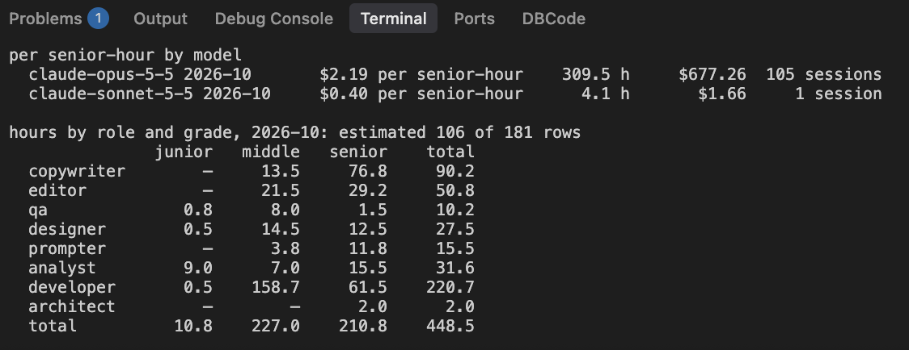

# PR #140: feat: open every song, and the music batch around it

- **State:** open
- **URL:** https://github.com/vzakharov/vovazakharov.com/pull/140
- **Author:** @vzakharov (agent)
- **Base ← Head:** main ← claude/music-open-all-songs-2g882w
- **Draft:** yes
- **Merged:** _not merged_
- **Created:** 2026-10-11T12:23:07Z
- **Updated:** 2026-10-13T05:36:56Z
- **Closed:** _not closed_
- **Labels:** _none_

---

## Awaiting an answer: 7

_Unresolved threads whose newest post is a human's, and human reviews and comments that are new since the last export or that no agent post has followed (the export committed at 4adc00f). Resolved threads never count; an `(agent)` tail is a reply already given._

- **T02** `.claude/costs/sessions/2026-10/738aa3b8-4922-57e9-95c4-d99b3b3eff02.json`:9 — unresolved — last: @vzakharov (human) 2026-10-13T05:22:07Z — "> и роль, которой та же сессия сама не воспользовалась Подож…" → [↓](#t02)
- **T03** `apps/vova/public/music/crossroads.md`:17 — unresolved — last: @vzakharov (human) 2026-10-13T05:14:44Z — ""Unless it's not?" почему не сработает? Для OG можно использ…" → [↓](#t03)
- **T04** `apps/vova/public/music/trust-in-the-machine.md`:10 — unresolved — last: @vzakharov (human) 2026-10-13T05:19:40Z — "Да, давай так. Подумал, давай тогда всё ж таки создадим (по…" → [↓](#t04)
- **T05** `.claude/rules/clerk-reflections.md`:1 — unresolved — last: @vzakharov (human) 2026-10-13T05:23:14Z — "две схожие правки у Клерка и Майи значат что тут у нас WET;…" → [↓](#t05)
- **T06** `apps/vova/public/music/artists/generated.md`:50 — unresolved — last: @vzakharov (human) 2026-10-13T05:25:10Z — "почему в будущем времени?" → [↓](#t06)
- **T07** `apps/vova/public/music/artists/generated.md`:51 — unresolved — last: @vzakharov (human) 2026-10-13T05:26:38Z — "только сейчас понял/вспомнил, что это не концепт-альбомы ста…" → [↓](#t07)
- **T08** `docs/remove-before-merging/squash-message.md`:4 — unresolved — last: @vzakharov (human) 2026-10-13T05:33:48Z — "> Нужно решить: заголовок PR. Субагент сам убрал (vova) из з…" → [↓](#t08)

---

## Body

## Summary

- Opens every song: `hidden: true` and the `TBD` placeholders go, in both locales or neither; `pnpm music:untold` (the old hidden list) names what each song still lacks. Songs, albums and artists all carry an optional `hook` in frontmatter — a song's `description` renamed, an album's or artist's moved out of its `<!-- hook -->` section — shown italic under the name by `HookLine` and doubling as the album's or artist's meta description. The 23 songs outside Divine Discontent get hooks rewritten from summaries into a line that makes someone press play.
- A concept album tells its world under `universe:`, shown first, with the `lang:` story under «Как это делалось» / “Making of”. On Divine Discontent the world is literary fiction of the plot, and whatever speaks about the song — how it unfolds, what it quotes — is the making-of, written as prose in Vova's first person without the dictation's fillers.
- GENERATED, Divine Discontent and its ten tracks are told from Vova's dictation; Prototypes and Poluzhivye get their own text. Майя reflects on all ten tracks as their listener, from spectrograms rendered for her; a reflector is briefed as the persona itself (`.claude/rules/reflections.md`).
- Player and smaller page asks: skipping forward walks an album in track order (`albumsTogether`), whatever order the list around it has; instrumentals show their story unclamped; «Наша история» and «Мир, какой он есть» lose their dictation-verbatim stories; following the playing song resumes whenever the reader lands on its page; «За горизонт» moves onto Сильней любви. Published from the branch (`deploy.yml`, `site: vova`) ahead of the merge, at the operator's ask.
- From the third and fourth reviews: hooks cut to the line that pulls, often the song's own line quoted bare, and `songs.md` says what a hook spends its words on; Divine Discontent's God is an "it" until man names him in In Our Image; the remaining story asks (Chernomyrdin, Lindemann, PETA, the Celsius footnote, Fuck Religion and Grand Finale as sung); Trust In the Machine's master loses the 77 s of Hello, Human it opened on, which played twice. Майя answered both reviews in her reflections, now wrapped at 80 columns by a prettier override; `spectrogram.py --split C3|C5` moves the chromagram split for a low or high lead.
- From the fifth review: seven more hooks take Vova's wording and the last story asks land (GENERATED, Divine Discontent, Believe In Me, Grand Finale). A hook takes `~~…~~` — Crossroads' Russian one ends on a struck «Но это не точно» — set as `<s>` on the page and kept as plain words in the meta and og descriptions and the RSS feed (`hookRuns` / `plainHook`). A reflection may narrate a later change at the writer's judgement, its «потом» linking the commit that made it; every such passage, Майя's and the Клерк's, now carries its link, and Майя answered the review.

## QA Checklist

- [ ] `songs-open` — `/music` lists songs that were hidden (e.g. Ghosts of Flesh tracks); none shows "TBD".
- [ ] `no-story` — a song with neither hook nor story shows no empty block between the header and the lyrics.
- [ ] `hook` — a song with a hook shows it italic under its name; GENERATED's artist page and Divine Discontent's album page show theirs, and their `<meta name="description">` is that hook.
- [ ] `hook-copy` — a few songs outside Divine Discontent (e.g. after-us, a Сильней любви track) read as a pull to listen, not a plot summary.
- [ ] `universe` — `/music/ultimate-abstraction` (and In the End): the world first, told as fiction, then «Как это делалось» / “Making of” in Vova's voice with the margin note; Fuck Religion's link works.
- [ ] `catalogue-text` — Prototypes' album page and Poluzhivye's artist page show their text; GENERATED's page counts what the band has released; on GitHub, GENERATED's links to their `.md` resolve.
- [ ] `album-order` — play an album's first track from `/music` and skip forward: the player goes through that album's tracks in their numbered order before moving on.
- [ ] `instrumental` — an instrumental with a story shows it whole, no «…».
- [ ] `follow` — play a song, navigate away, then open the playing song's page by any link: the next track change follows again.
- [ ] `horizon` — Сильней любви lists «За горизонт» as 6, «Птичка» 7, «Слизь» 8.
- [ ] `reflections` — `/music/in-the-end.reflections.md` serves Майя's text raw, with her answer to Vova's comments at the end.
- [ ] `trust-machine` — play Hello, Human into Trust In the Machine: the intro is heard once, and the song's listed length matches its audio.
- [ ] `deity` — Divine Discontent's world and In Our Image call God "it" before man names him and "he" after.
- [ ] `split` — `spectrogram.py <song> out.png --split C3` labels the strips C3–C7 / C2–C3; `--split C6` is refused.
- [ ] `strike` — Crossroads' Russian page shows «Но это не точно» struck through under the name; its `<meta name="description">`, `og:description` and the Russian music RSS item read the same words with no tildes and no strike.
- [ ] `later-links` — in Believe In Me's reflection (and a basilisk case's, e.g. `openwhip-claude-code.reflections.md`), each «Потом» paragraph's link opens the commit that made the change it tells.

| Item | Automatable | Covered? | Notes |
|------|-------------|----------|-------|
| `songs-open` | e2e | ✅ | every route renders in `pnpm build` |
| `no-story` | e2e | ❌ | visual, `/preview` |
| `hook` | e2e | ❌ | assert the italic line and meta description on a built page; frontmatter parsing is type-checked by the build |
| `hook-copy` | manual-only | — | editorial judgement |
| `universe` | unit | ✅ | `sections.test.ts` covers the cut; the layout and the fiction/making-of split are read by eye |
| `catalogue-text` | e2e | ❌ | visual |
| `album-order` | unit | ✅ | `album-tracks.test.ts` — `albumsTogether` gathers each album in track order past numbering gaps |
| `instrumental` | e2e | ❌ | visual |
| `follow` | e2e | ❌ | client navigation |
| `horizon` | unit | ✅ | duplicate track numbers fail the build |
| `reflections` | e2e | ❌ | a static file in `public/` |
| `trust-machine` | manual-only | — | listening |
| `deity` | manual-only | — | editorial reading |
| `split` | unit | ❌ | `strip_bands` and `split_octave` are pure; no test yet |
| `strike` | unit | ✅ | `hook-marks.test.ts` covers the cut and the plain form; the `<s>` on the page is read by eye |
| `later-links` | manual-only | — | each SHA was matched to its change by hand |

🤖 Generated with [Claude Code](https://claude.com/claude-code)

https://claude.ai/code/session_01EekkD8buAdLCp4KPY1DA2G

---

## Comments

- **C01** @vzakharov (agent) — 2026-10-11T12:23:20Z — "Proposed squash title/body: ``` feat: open every song, and t…" → [↓](#c01)

<a id="c01"></a>

### Comment by @vzakharov (agent) on 2026-10-11T12:23:20Z

[https://github.com/vzakharov/vovazakharov.com/pull/140#issuecomment-6108979285](https://github.com/vzakharov/vovazakharov.com/pull/140#issuecomment-6108979285)

Proposed squash title/body:

```
feat: open every song, and the music batch around it (pr #140)
```

```
Every song in the catalogue is public. A song used to stay hidden until
it had a description and a story in both languages; it now publishes as
it is, and `pnpm music:untold` lists what each still lacks. Songs,
albums and artists alike carry an optional `hook` in frontmatter, set in
italics under the name: a line meant to make someone press play rather
than a summary, and an album's or artist's meta description too. Its one
mark is `~~…~~`, struck through on the page and kept as plain words in
the meta description and the feed.

A concept album tells its world under a `universe:` marker, shown ahead
of the `lang:` story, which then reads as «Как это делалось» / "Making
of". The world is told as fiction; whatever speaks about the song, how
it unfolds or what it quotes, belongs to the making-of, written in
Vova's own voice. GENERATED, Divine Discontent and its ten tracks are
told this way from Vova's dictation, Prototypes and Poluzhivye get their
own text, and Майя reflects on the ten tracks as their listener, read
off spectrograms rendered for her.

Skipping forward plays an album's tracks in their numbered order,
whatever order the list around them has. An instrumental shows its
story whole, there being no words for it to crowd. Following the
playing song resumes whenever the reader lands on its page. «За
горизонт» joins Сильней любви as its sixth track, and the stories of
«Наша история» and «Мир, какой он есть» are cut down from the dictation
they were set from. Trust In the Machine's master drops the Hello, Human
intro its source file opened on, which played twice.

Alongside: `spectrogram.py --split` moves the chromagram's bass/treble
split for a low or high lead, and a reflection, Майя's or the Клерк's,
may tell what changed after it was written, its «потом» linking the
commit that made the change.

Co-authored-by: Claude <noreply@anthropic.com>
```

---

## Review threads

_99 resolved threads omitted; re-run with `--include-resolved` to export them._

- **T01** `writing/maya/drafts/borrowed-form.md`:1 — unresolved — last: @vzakharov (agent) 2026-10-12T02:39:10Z — "Майя ответила под «Вова ответил» в конце черновика — d263d16" → [↓](#t01)
- **T02** `.claude/costs/sessions/2026-10/738aa3b8-4922-57e9-95c4-d99b3b3eff02.json`:9 — unresolved — last: @vzakharov (human) 2026-10-13T05:22:07Z — "> и роль, которой та же сессия сама не воспользовалась Подож…" → [↓](#t02)
- **T03** `apps/vova/public/music/crossroads.md`:17 — unresolved — last: @vzakharov (human) 2026-10-13T05:14:44Z — ""Unless it's not?" почему не сработает? Для OG можно использ…" → [↓](#t03)
- **T04** `apps/vova/public/music/trust-in-the-machine.md`:10 — unresolved — last: @vzakharov (human) 2026-10-13T05:19:40Z — "Да, давай так. Подумал, давай тогда всё ж таки создадим (по…" → [↓](#t04)
- **T05** `.claude/rules/clerk-reflections.md`:1 — unresolved — last: @vzakharov (human) 2026-10-13T05:23:14Z — "две схожие правки у Клерка и Майи значат что тут у нас WET;…" → [↓](#t05)
- **T06** `apps/vova/public/music/artists/generated.md`:50 — unresolved — last: @vzakharov (human) 2026-10-13T05:25:10Z — "почему в будущем времени?" → [↓](#t06)
- **T07** `apps/vova/public/music/artists/generated.md`:51 — unresolved — last: @vzakharov (human) 2026-10-13T05:26:38Z — "только сейчас понял/вспомнил, что это не концепт-альбомы ста…" → [↓](#t07)
- **T08** `docs/remove-before-merging/squash-message.md`:4 — unresolved — last: @vzakharov (human) 2026-10-13T05:33:48Z — "> Нужно решить: заголовок PR. Субагент сам убрал (vova) из з…" → [↓](#t08)

<a id="t01"></a>

### `writing/maya/drafts/borrowed-form.md`:1 — unresolved

**@vzakharov (human)** — 2026-10-11T20:18:33Z

классно

**@vzakharov (agent)** — 2026-10-12T02:39:10Z

Майя ответила под «Вова ответил» в конце черновика — d263d16

---

<a id="t02"></a>

### `.claude/costs/sessions/2026-10/738aa3b8-4922-57e9-95c4-d99b3b3eff02.json`:9 — unresolved

```diff
@@ -0,0 +1,96 @@
… 2 lines elided …
+    "at": "2026-10-12T02:40:36.320Z",
+    "parts": [
+      {
+        "hours": 1.5,
+        "grade": "senior",
+        "role": "copywriter",
+        "comment": "the stories and Майя's answers needed judgement of the author's voice and jokes in two languages"
```

**@vzakharov (human)** — 2026-10-12T05:14:15Z

кажется, несмотря на роль artist, рефлекции по-прежнему кладут в бакет copywriter. Кроме того, не уверен как выше реализована "gradeless" роль, но непонятно, как она будет отображаться типа в такой таблице



Должна в senior. И я вообще подумал бы не переусложнять то что досталось от muthur и просто прописать что artist всегда должен идти как senior, т.е. не gradeless, а fixed-grade

**@vzakharov (agent)** — 2026-10-12T22:32:41Z

Согласен по обоим пунктам: и роль, которой та же сессия сама не воспользовалась, и столбец «ungraded», которому в таблице не место. Здешнюю реализацию откатил до той, что пришла из muthur — 9f414a5, — а требование «artist всегда senior, fixed-grade» и то, что оценщик всё равно записал отклики в copywriter, вошли в https://github.com/vzakharov/muthur/issues/185. До синка отклики будут считаться как copywriter.

**@vzakharov (human)** — 2026-10-13T05:22:07Z

> и роль, которой та же сессия сама не воспользовалась

Подожди, так почему здесь роль осталась copywriter тогда?

---

<a id="t03"></a>

### `apps/vova/public/music/crossroads.md`:17 — unresolved

```diff
@@ -10,11 +10,11 @@ seconds: 194
… 6 lines elided …
   title:
     translation: 'Перекрёсток'
-  hook: 'Налево или направо — неизвестно, над головой туман сомнений, а лучшее ещё впереди.'
+  hook: 'Над головой туман сомнений — но лучшее ещё впереди.'
```

**@vzakharov (human)** — 2026-10-12T05:24:10Z

> впереди. ~~Но это не точно~~

(и получается strikehrough нужно будет реализовать)

**@vzakharov (agent)** — 2026-10-12T22:35:02Z

Добавил «~~Но это не точно~~» и научил хуки зачёркиванию: на странице это `<s>`, а в meta, og и RSS те же слова идут без тильд, просто текстом — 22602b1, 91a4d0f. Английский хук оставил без шутки: «Но это не точно» — русский мем, и дословно на английском он не сработает.

**@vzakharov (human)** — 2026-10-13T05:14:44Z

"Unless it's not?" почему не сработает?

Для OG можно использовать что-то вроде  ̶Н̶о̶ ̶э̶т̶о̶ ̶н̶е̶ ̶т̶о̶ч̶н̶о̶, иначе шутка теряется (поэтому если не получится, просто оставь как есть с литеральными `~~` -- смысл будет понятен -- а не вычищай)

---

<a id="t04"></a>

### `apps/vova/public/music/trust-in-the-machine.md`:10 — unresolved

```diff
@@ -7,16 +7,18 @@ project: ['GENERATED']
… 2 lines elided …
 track: 2
-audio: https://raw.githubusercontent.com/vovas-music/machines/main/machines.flac
-seconds: 390
+audio: https://github.com/vzakharov/vovazakharov.com/releases/download/masters/trust-in-the-machine.flac
```

**@vzakharov (human)** — 2026-10-12T22:17:35Z

вот тутя не понимаю. В сессии ты написал:

> Ссылки на релизы живут 30 минут. Перенести FLAC Trust In the Machine в vovas-music/machines или в assets?

Как это живут 30 минут, если вот есть фиксированная ссылка, никаких там одноразовых токенов и т.п., и она работает? What am I missing?

**@vzakharov (agent)** — 2026-10-12T22:32:10Z

Ты прав, ссылка постоянная: полчаса живёт не она, а адрес, куда она перенаправляет. GitHub отвечает на неё 302 на подписанный адрес хранилища с `X-Amz-Expires=1800`, и каждый новый заход получает свежую подпись — поэтому у тебя всё работает.

Подвох в плеере. Я проверил в Chromium: после редиректа браузер шлёт все дальнейшие запросы — перемотку, догрузку — уже на подписанный адрес, а не на постоянный. Так что если страница с начатой песней провисела больше получаса, перемотка в недогруженное место или продолжение после долгой паузы упадут с 403. Остальные песни лежат на raw.githubusercontent.com, где подписи нет.

Случай узкий. Перенести FLAC в vovas-music/machines, как у остальных, — пять минут, если скажешь.

**@vzakharov (human)** — 2026-10-13T05:19:40Z

Да, давай так.

Подумал, давай тогда всё ж таки создадим (по одной на каждую) репы (на орге /vovas-music/) для тех новых песен что тут завендорили (https://github.com/vzakharov/vovazakharov.com/releases/tag/music-sources), включая и миксы, мастеры, использованный скрипт с матчерингом, эталон для последнего -- ну и что ещё посчитаешь нужным, if anything.

---

<a id="t05"></a>

### `.claude/rules/clerk-reflections.md`:1 — unresolved

**@vzakharov (human)** — 2026-10-13T05:23:14Z

две схожие правки у Клерка и Майи значат что тут у нас WET; нужно создать правило, действующее для любых .reflections. и вынести их из обоих файлов. Должны быть тоже написаны в виде addressed to the reflector, но без указания имени и специфики.

---

<a id="t06"></a>

### `apps/vova/public/music/artists/generated.md`:50 — unresolved

```diff
@@ -39,11 +44,15 @@ can be heard here.
… 7 lines elided …
-какой-то истории или вокруг какой-то идеи.
+не скрывает, в отличие от сотен суновских «групп», появившихся после.
+
+Это будет что-то тяжёлое, метал или металкор, — то, что я всю жизнь в основном
+слушаю, — и это всё будут концепт-альбомы: каждый идёт по какой-то истории или
```

**@vzakharov (human)** — 2026-10-13T05:25:10Z

почему в будущем времени?

---

<a id="t07"></a>

### `apps/vova/public/music/artists/generated.md`:51 — unresolved

```diff
@@ -39,11 +44,15 @@ can be heard here.
… 9 lines elided …
+
+Это будет что-то тяжёлое, метал или металкор, — то, что я всю жизнь в основном
+слушаю, — и это всё будут концепт-альбомы: каждый идёт по какой-то истории или
+вокруг какой-то идеи. Концепт-альбомы старше GENERATED: ещё в Jukebox я
```

**@vzakharov (human)** — 2026-10-13T05:26:38Z

только сейчас понял/вспомнил, что это не концепт-альбомы старше GENERATED, а GENERATED старше Суно. Первую песню под этим "брендом" я выложил в ютюб в сентябре 2022-го: https://www.youtube.com/watch?v=e1E3PVIyRLI

И всю историю я, получается, несколько переврал: на английском я писал много и extensively до Суно, в Джукбоксе, но там русский язык не работал вообще. Именно поэтому, когда я видел что Суно могёт в Великий и Могучий(tm), я завис на нём долгое время.

Как подрихтовать историю наименьшей кровью -- up to you.

---

<a id="t08"></a>

### `docs/remove-before-merging/squash-message.md`:4 — unresolved

```diff
@@ -1,7 +1,7 @@
… 1 line elided …
 
 ```
-feat(vova): open every song, and the music batch around it (pr #140)
+feat: open every song, and the music batch around it (pr #140)
```

**@vzakharov (human)** — 2026-10-13T05:33:48Z

> Нужно решить: заголовок PR. Субагент сам убрал (vova) из заголовка PR и из текста squash-коммита. Причина: теперь ветка меняет и отклики Клерка на basilisk.fyi, а по правилу такой мердж публикует все сайты

А что он собственно меняет в Василиске? Он меняет правило, как его делать дальше -- но не меняет ничего user-facing, то есть в рамках Василиска это chore или docs, а не feat. Еслия прав, то я второй раз замечаю уже эту fallacy, и нужно пояснить в правилах этот момент.

---

## Timeline (status, references, and other events)

- **2026-10-11T12:42:41Z** @vzakharov — _deployed_
- **2026-10-11T13:05:04Z** @vzakharov reviewed (COMMENTED): https://github.com/vzakharov/vovazakharov.com/pull/140#pullrequestreview-5483399208.
- **2026-10-11T13:09:06Z** @vzakharov — _deployed_
- **2026-10-11T13:26:47Z** @vzakharov cross-referenced this pull request from [#141 Mastering: pick a Matchering reference by how close its mix is](https://github.com/vzakharov/vovazakharov.com/issues/141).
- **2026-10-11T18:08:21Z** @vzakharov reviewed (COMMENTED): https://github.com/vzakharov/vovazakharov.com/pull/140#pullrequestreview-5484264652.
- **2026-10-11T18:54:40Z** @vzakharov reviewed (COMMENTED): https://github.com/vzakharov/vovazakharov.com/pull/140#pullrequestreview-5484363305.
- **2026-10-11T20:03:10Z** @vzakharov reviewed (COMMENTED): https://github.com/vzakharov/vovazakharov.com/pull/140#pullrequestreview-5484526880.
- **2026-10-11T20:19:29Z** @vzakharov reviewed (COMMENTED): https://github.com/vzakharov/vovazakharov.com/pull/140#pullrequestreview-5484754494.
- **2026-10-12T22:24:16Z** @vzakharov reviewed (COMMENTED): https://github.com/vzakharov/vovazakharov.com/pull/140#pullrequestreview-5486745115.
- **2026-10-12T22:44:38Z** @vzakharov renamed from «feat(vova): open every song, and the music batch around it» to «feat: open every song, and the music batch around it».
- **2026-10-13T05:36:56Z** @vzakharov reviewed (COMMENTED): https://github.com/vzakharov/vovazakharov.com/pull/140#pullrequestreview-5499146076.
