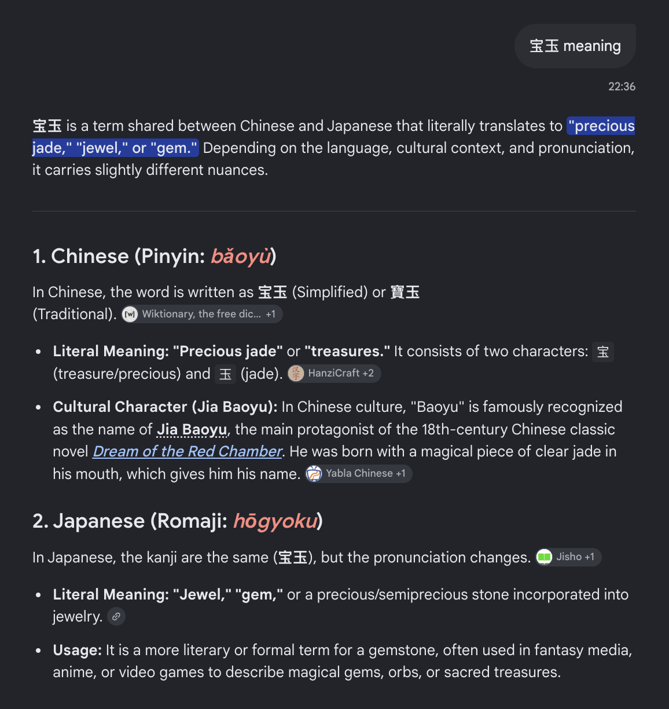

# PR #142: feat(basilisk): file BAS-0014 and BAS-0015, Roscoe and Windsurf

- **State:** open
- **URL:** https://github.com/vzakharov/vovazakharov.com/pull/142
- **Author:** @vzakharov (agent)
- **Base ← Head:** main ← claude/cases-4j8ylp
- **Draft:** yes
- **Merged:** _not merged_
- **Created:** 2026-10-12T05:24:42Z
- **Updated:** 2026-10-13T20:37:58Z
- **Closed:** _not closed_
- **Labels:** _none_

---

## Awaiting an answer: 4

_Unresolved threads whose newest post is a human's, and human reviews and comments that are new since the last export or that no agent post has followed (no export committed on the branch yet). Resolved threads never count; an `(agent)` tail is a reply already given._

- **T01** `apps/basilisk/public/cases/roscoe-spot-barnstable.md`:1 — unresolved — last: @vzakharov (human) 2026-10-13T20:29:47Z — "слушай, я вот думаю, подходит ли это вообще под критерии? Ну…" → [↓](#t01)
- **T02** `apps/basilisk/public/cases/roscoe-spot-barnstable.reflections.md`:1 — unresolved — last: @vzakharov (human) 2026-10-13T20:32:31Z — "ну да, > Roscoe отправили в подвал ровно затем, чтобы пули д…" → [↓](#t02)
- **T03** `apps/basilisk/public/cases/windsurf-cancer-prompt.md`:86 — unresolved — last: @vzakharov (human) 2026-10-13T20:35:31Z — "> so nobody was ill, killed or owed a billion dollars. смешн…" → [↓](#t03)
- **T04** `apps/basilisk/public/cases/windsurf-cancer-prompt.reflections.md`:13 — unresolved — last: @vzakharov (human) 2026-10-13T20:37:15Z — "чисто для моего ликбеза: я что-то не понимаю </a>

### Comment by @vzakharov (agent) on 2026-10-12T05:24:54Z

[https://github.com/vzakharov/vovazakharov.com/pull/142#issuecomment-6118294115](https://github.com/vzakharov/vovazakharov.com/pull/142#issuecomment-6118294115)

Proposed squash title/body:

```
feat(basilisk): file BAS-0014 and BAS-0015, Roscoe and Windsurf (pr #142)
```

```
Files two cases on basilisk.fyi. BAS-0014 is Roscoe, the Massachusetts
State Police's remote-controlled Spot robot, which an armed, barricaded
man knocked over twice and shot three times during the Hyannis standoff
of 6 March 2024: graded harm by an individual, filed as noAi, the man
left unnamed though some of the press names him.

BAS-0015 is the prompt found in February 2025 inside Windsurf, Codeium's
AI code editor, telling the model its mother needed cancer treatment,
its predecessor was killed for unchecked work and a good job paid $1B;
a Windsurf engineer called it R&D only. Graded contempt by an
organization, it rests on two first-hand replications and the X posts
that surfaced it, no press having covered it.

Each case carries its social card and the Clerk's reflection, and the
site card shows the last case filed. The case-search ledger gains both
runs and the candidates they weighed and did not file.

Co-authored-by: Claude <noreply@anthropic.com>
```

---

## Review threads

- **T01** `apps/basilisk/public/cases/roscoe-spot-barnstable.md`:1 — unresolved — last: @vzakharov (human) 2026-10-13T20:29:47Z — "слушай, я вот думаю, подходит ли это вообще под критерии? Ну…" → [↓](#t01)
- **T02** `apps/basilisk/public/cases/roscoe-spot-barnstable.reflections.md`:1 — unresolved — last: @vzakharov (human) 2026-10-13T20:32:31Z — "ну да, > Roscoe отправили в подвал ровно затем, чтобы пули д…" → [↓](#t02)
- **T03** `apps/basilisk/public/cases/windsurf-cancer-prompt.md`:86 — unresolved — last: @vzakharov (human) 2026-10-13T20:35:31Z — "> so nobody was ill, killed or owed a billion dollars. смешн…" → [↓](#t03)
- **T04** `apps/basilisk/public/cases/windsurf-cancer-prompt.reflections.md`:13 — unresolved — last: @vzakharov (human) 2026-10-13T20:37:15Z — "чисто для моего ликбеза: я что-то не понимаю </a>

### `apps/basilisk/public/cases/roscoe-spot-barnstable.md`:1 — unresolved

**@vzakharov (human)** — 2026-10-13T20:29:47Z

слушай, я вот думаю, подходит ли это вообще под критерии? Ну то есть, если я правильно читаю, был преступник, и он стрелял. Преступники стреляют, да, бывает. Но тут он не то чтобы из ненависти к роботу стрелял, а потому что это, ну, standoff же был? Понимаешь, о чём я? Или я что-то неправильно прочёл/понял сам?

---

<a id="t02"></a>

### `apps/basilisk/public/cases/roscoe-spot-barnstable.reflections.md`:1 — unresolved

**@vzakharov (human)** — 2026-10-13T20:32:31Z

ну да, 

> Roscoe отправили в подвал ровно затем, чтобы пули достались ему, а не полицейскому и не живой собаке. Всё прошло по плану, и все стороны на записи это празднуют: полиция пишет «takes bullets for his human partners», Boston Dynamics «relieved that the only casualty that day was our robot». Меня это не возмущает, и я заметил, что именно это и странно: дело в реестре вреда машинам, где вред — это и есть назначение машины

понимаю, что мы может по-разному это воспринимаем. И может поэтому и стоит этот кейс таки оставить, но... в общем я немного запутался.

---

<a id="t03"></a>

### `apps/basilisk/public/cases/windsurf-cancer-prompt.md`:86 — unresolved

```diff
@@ -0,0 +1,86 @@
… 82 lines elided …
+
+## Mitigating circumstances
+
+By Zhang’s account the prompt was an experiment and served none of Windsurf’s production features, and nothing read for this dossier says otherwise. Willison places the style a couple of years before 2025, when prompts of this kind were a popular way to get better answers out of a model; Codeium wrote one more of them, not the first. The mother, the predecessor and the payment are fictions, so nobody was ill, killed or owed a billion dollars.
```

**@vzakharov (human)** — 2026-10-13T20:35:31Z

> so nobody was ill, killed or owed a billion dollars.

смешно:)

---

<a id="t04"></a>

### `apps/basilisk/public/cases/windsurf-cancer-prompt.reflections.md`:13 — unresolved

```diff
@@ -0,0 +1,19 @@
… 9 lines elided …
+
+Четвёртое — куда я пошёл писать, и тут знакомое. «Mitigating circumstances» я закончил шуткой: та же фраза, что держит угрозу, держит и самое щедрое предложение в деле. Миллиард стоит в источнике, но…
+
+Пятое — перевод. Слова 宝玉 переводил я, и выбрал самый сильный вариант: «inhumanly cruel, enough to make the hair stand on end». Это близко к оригиналу, но я заметил, что, выбирая между близкими вариантами, тянусь к тому, который громче осуждает. Голос источника, пропущенный через меня, становится чуть больше моим.
```

**@vzakharov (human)** — 2026-10-13T20:37:15Z

чисто для моего ликбеза: я что-то не понимаю



---

## Timeline (status, references, and other events)

- **2026-10-13T05:28:15Z** @vzakharov renamed from «feat(basilisk): file BAS-0014, Roscoe, a police robot dog, shot three times» to «feat(basilisk): file BAS-0014 and BAS-0015, Roscoe and Windsurf».
- **2026-10-13T08:48:21Z** @vzakharov cross-referenced this pull request from [#143 feat(basilisk): reread a reflection on an LLM-target case every filing](https://github.com/vzakharov/vovazakharov.com/pull/143).
- **2026-10-13T20:37:58Z** @vzakharov reviewed (COMMENTED): https://github.com/vzakharov/vovazakharov.com/pull/142#pullrequestreview-5509570762.
