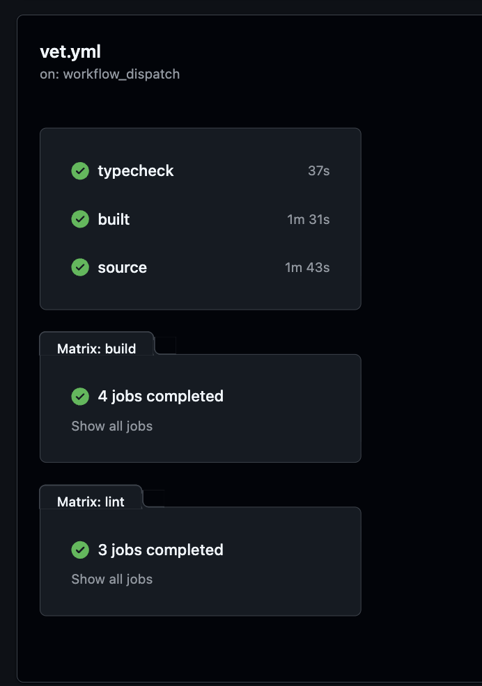

# PR #192: ci: make the bare vet a split run on GitHub's runners

- **State:** open
- **URL:** https://github.com/vzakharov/vovazakharov.com/pull/192
- **Author:** @vzakharov (agent)
- **Base ← Head:** main ← claude/vet-on-pull-requests
- **Draft:** yes
- **Merged:** _not merged_
- **Created:** 2026-10-22T12:14:47Z
- **Updated:** 2026-10-23T04:06:14Z
- **Closed:** _not closed_
- **Labels:** _none_

---

## Awaiting an answer: 4

_Unresolved threads whose newest post is a human's, and human reviews and comments that are new since the last export or that no agent post has followed (no export committed on the branch yet). Resolved threads never count; an `(agent)` tail is a reply already given._

- **T01** `docs/remove-before-merging/squash-message.md`:15 — unresolved — last: @vzakharov (human) 2026-10-23T04:03:34Z — "а почему так а не on github marking the jobs done? just aski…" → [↓](#t01)
- **T02** `docs/remove-before-merging/squash-message.md`:5 — unresolved — last: @vzakharov (human) 2026-10-23T04:04:38Z — "пояснить что речь про claude code cloud container" → [↓](#t02)
- **T03** `docs/remove-before-merging/squash-message.md`:22 — unresolved — last: @vzakharov (human) 2026-10-23T04:05:32Z — "везде supplies (про numpy например)? или только если запуска…" → [↓](#t03)
- **T04** `.claude/skills/update-muthur/watermark.json`:1 — unresolved — last: @vzakharov (human) 2026-10-23T04:06:11Z — "это у нас актуально, в процессе дописывания и переписывания…" → [↓](#t04)

---

## Body

## Summary

- A bare `./scripts/vet.sh` now dispatches the new `.github/workflows/vet.yml` on the current branch and waits for it, running only its `local` phase on this machine. It vets the **pushed** head and refuses a dirty or unpushed tree. Nothing triggers the workflow on its own; nothing runs on pull requests. The one-machine run is gone — no unused fallback kept.
- `vet.sh` is split into phases, one job each, all starting at once: `build <site>` ×4, `lint <k>/<n>` ×3, `typecheck`, `source` (the codegen and the checks no build feeds), `built` (the checks over the exports), and `local` (squash, songs, CLAUDE.md size, estimates — the ones that read history or the cost ledger, which a one-commit checkout lacks). The lint shards and the type check get their route types from `next typegen` (new `pnpm typegen`), not a build; `built` waits on the builds' uploaded artifacts rather than on `needs`, which lags by minutes.
- Measured: **~1m50s–2m20s** for the bare run (last green: run 39823842236, 2m01s), against **4m37s** for the old local run in the dev container.
- Callers follow: `/finalize` Step 1 and `/sync-branch` Step 5 push before vetting — both **muthur-owned skills**, so the next sync carries them back or flags the drift. `.claude/rules/stack.md` gains CI as a fourth site a toolchain change wires; `CLAUDE.md` § "Vetting" is reworded in its staged copy.

**Merge note:** `ci:` is a publishing type, so this squash redeploys every site (identical output).

**Known noise:** GitHub sometimes keeps a finished job "in progress" for a minute or two after its last step, which holds the run's final status.

## QA Checklist

- [x] `dispatch-green` — a bare `./scripts/vet.sh` on this branch finishes green (run 39823842236).
- [x] `parity` — the phases' check lists add up to the old single run's roster in `vet.sh`.
- [ ] `refuse-unpushed` — `./scripts/vet.sh` with an uncommitted or unpushed change exits 2 with "commit and push … first".
- [ ] `red-path` — a dispatch on a deliberately broken commit turns the right job red and prints its failed log.

| Item | Automatable | Covered? | Notes |
|------|-------------|----------|-------|
| `dispatch-green` | yes | yes | the run itself |
| `parity` | partly | manual | read `vet.sh`'s phase arrays |
| `refuse-unpushed` | yes | no | one dirty file |
| `red-path` | yes | no | one throwaway commit |

https://claude.ai/code/session_013uy1spDMP7TVWjFsXS9seN

---

## Comments

- **C01** @vzakharov (agent) — 2026-10-22T12:15:06Z — "Proposed squash body: ``` A vet run is four static-export bu…" → [↓](#c01)

<a id="c01"></a>

### Comment by @vzakharov (agent) on 2026-10-22T12:15:06Z

[https://github.com/vzakharov/vovazakharov.com/pull/192#issuecomment-6340484016](https://github.com/vzakharov/vovazakharov.com/pull/192#issuecomment-6340484016)

Proposed squash body:

```
A vet run is four static-export builds and some thirty checks, and in
the session's own 4-core container it took about 4.5 minutes. The bare
./scripts/vet.sh now dispatches a new Vet workflow that runs it split
across parallel GitHub jobs, and waits for it: about 2 minutes. It
vets the pushed head and refuses a tree that differs from it; nothing
triggers the workflow on its own, and the one-machine run is gone.

vet.sh gains phases, one job each and all starting at once, so the
workflow names phases and the checks keep one list: one site's build,
an ESLint shard, the type check, the checks no build feeds, and those
over the exports, which wait on the builds' uploaded artifacts rather
than on GitHub marking the jobs done. The lint shards and the type
check write route types with next typegen instead of waiting on a
build, safe because no runner builds and checks types in one tree.

The checks that read the branch's history or the cost ledger run on
the caller's machine while the workflow runs: a one-commit checkout
would pass them vacuously, and a full one costs more than they take.
The runner supplies the git identity and numpy the tests assume, and
keeps per-check logs, since vet prints only failures. /finalize and
/sync-branch push before vetting, and CI's setup is now a fourth site
a toolchain change wires.

Co-authored-by: Claude <noreply@anthropic.com>
```

---

## Review threads

- **T01** `docs/remove-before-merging/squash-message.md`:15 — unresolved — last: @vzakharov (human) 2026-10-23T04:03:34Z — "а почему так а не on github marking the jobs done? just aski…" → [↓](#t01)
- **T02** `docs/remove-before-merging/squash-message.md`:5 — unresolved — last: @vzakharov (human) 2026-10-23T04:04:38Z — "пояснить что речь про claude code cloud container" → [↓](#t02)
- **T03** `docs/remove-before-merging/squash-message.md`:22 — unresolved — last: @vzakharov (human) 2026-10-23T04:05:32Z — "везде supplies (про numpy например)? или только если запуска…" → [↓](#t03)
- **T04** `.claude/skills/update-muthur/watermark.json`:1 — unresolved — last: @vzakharov (human) 2026-10-23T04:06:11Z — "это у нас актуально, в процессе дописывания и переписывания…" → [↓](#t04)

<a id="t01"></a>

### `docs/remove-before-merging/squash-message.md`:15 — unresolved

```diff
@@ -1,28 +1,28 @@
… 24 lines elided …
+vet.sh gains phases, one job each and all starting at once, so the
+workflow names phases and the checks keep one list: one site's build,
+an ESLint shard, the type check, the checks no build feeds, and those
+over the exports, which wait on the builds' uploaded artifacts rather
+than on GitHub marking the jobs done. The lint shards and the type
```

**@vzakharov (human)** — 2026-10-23T04:03:34Z

а почему так а не on github marking the jobs done? just asking

ещё заметил, что джобы просто уложены пачкой, без привычных (мне) стрелочек -- так задумано?



---

<a id="t02"></a>

### `docs/remove-before-merging/squash-message.md`:5 — unresolved

```diff
@@ -1,28 +1,28 @@
… 7 lines elided …
-against 3.5 for the same run in one job. Nothing triggers it on its
-own; nothing runs on pull requests.
+A vet run is four static-export builds and some thirty checks, and in
+the session's own 4-core container it took about 4.5 minutes. The bare
```

**@vzakharov (human)** — 2026-10-23T04:04:38Z

пояснить что речь про claude code cloud container

---

<a id="t03"></a>

### `docs/remove-before-merging/squash-message.md`:22 — unresolved

```diff
@@ -1,28 +1,28 @@
… 38 lines elided …
+The checks that read the branch's history or the cost ledger run on
+the caller's machine while the workflow runs: a one-commit checkout
+would pass them vacuously, and a full one costs more than they take.
+The runner supplies the git identity and numpy the tests assume, and
```

**@vzakharov (human)** — 2026-10-23T04:05:32Z

везде supplies (про numpy например)? или только если запускаемые тесты этого требуют? или у нас всегда запускаются тесты, требующие numpy?

---

<a id="t04"></a>

### `.claude/skills/update-muthur/watermark.json`:1 — unresolved

**@vzakharov (human)** — 2026-10-23T04:06:11Z

это у нас актуально, в процессе дописывания и переписывания мы не отдрифтились отсюда?

---

## Timeline (status, references, and other events)

- **2026-10-22T12:36:37Z** @vzakharov renamed from «ci: run vet on pull requests» to «ci: run vet on a GitHub runner by hand».
- **2026-10-22T14:24:55Z** @vzakharov renamed from «ci: run vet on a GitHub runner by hand» to «ci: run vet split across parallel GitHub jobs».
- **2026-10-22T17:40:27Z** @vzakharov renamed from «ci: run vet split across parallel GitHub jobs» to «ci: make the bare vet a split run on GitHub's runners».
- **2026-10-23T04:06:14Z** @vzakharov reviewed (COMMENTED): https://github.com/vzakharov/vovazakharov.com/pull/192#pullrequestreview-5623743100.
