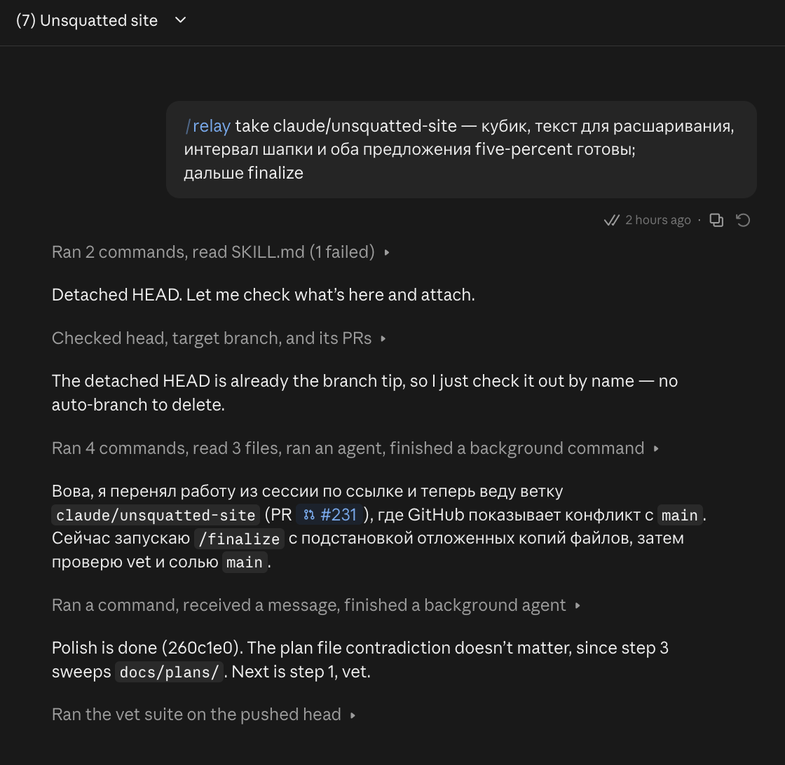

# PR #231: feat(unsquatted): unsquatted.com, free domain names and a checker

- **State:** open
- **URL:** https://github.com/vzakharov/vovazakharov.com/pull/231
- **Author:** @vzakharov (agent)
- **Base ← Head:** main ← claude/unsquatted-site
- **Draft:** yes
- **Merged:** _not merged_
- **Created:** 2026-10-29T08:36:23Z
- **Updated:** 2026-10-29T12:51:26Z
- **Closed:** _not closed_
- **Labels:** _none_

---

## Awaiting an answer: 3

_Unresolved threads whose newest post is a human's, and human reviews and comments that are new since the last export or that no agent post has followed (the export committed at c5788e8). Resolved threads never count; an `(agent)` tail is a reply already given._

- **T01** `src/unsquatted/pages/home/lib/lookup.ts`:44 — unresolved — last: @vzakharov (human) 2026-10-29T12:39:21Z — ".si это super intelligence (спасибо дедушке Трампу:), верни…" → [↓](#t01)
- **T03** `CLAUDE.md`:1 — unresolved — last: @vzakharov (human) 2026-10-29T12:44:31Z — "эм, я не запускал finalize. В той сессии (она с другого акка…" → [↓](#t03)
- **T04** `src/blog/scripts/lib/read-collection.ts`:86 — unresolved — last: @vzakharov (human) 2026-10-29T12:46:48Z — "давай сделаем `withCause(error) = { cause: asError(error) }`" → [↓](#t04)

---

## Body

## Summary

- **A sixth site, `unsquatted` (unsquatted.com), on shell.** One page with two halves: a curated list of good domain names still free, and a domainr-like checker that asks each registry's RDAP straight from the visitor's browser, with DNS-over-HTTPS as a hint where RDAP refuses browsers. No server, which is where "blazing-fast" comes from; the lede's asterisk after "grabbed" answers "* No, not even us."
- **The list** is one file per name, `sites/unsquatted/public/picks/<domain>.md`, its category, blurb, `added` and a float `score` in frontmatter; it is sorted by score, best first, so a new name slots in between two others. A name the routine finds taken gets `shownUntil` and leaves the list after it, its file kept. Each row is re-checked on load and shows its zone's Porkbun price beside "grab →".
- **The checker:**
  - Lookups run as you type, with a debounce, a Check button with a loader, and dice rolling an adjective + noun.
  - Every root zone Porkbun sells (539) is checkable. A typed zone leads, then `.com`, then split names (`fuckapp` → `fuck.app`; a leading zone splits only where the rest runs dictionary words together), then the rest (`com net org io ai co app dev me xyz sh gg`) — three rows, more behind "more tlds ↓".
  - The browser checks registry answers with type guards of its own, and Porkbun's list is read at build only, so no zod reaches the page.
  - The query lives in the URL hash, each change a history step.
  - Verdicts read "grab →", "grab-ish →" (DNS only), or "taken", whose note gives the registration's expiry date; "up for grabs in N" shows only in RDAP `pending delete`. Typing `unsquatted.com` answers "seriously?".
- **Shared code it brought up:** `NotedSpan` moved to `shell/shared/ui` (unsquatted's asides use it, Tooltip is gone); kernel gains `fetchOk`, `errorClass`, `asError` and `useProvided` (music's fetcher and player use them too; `asError` replaces six hand-written non-Error wraps in blog, mushrooms and unsquatted), held by a new lint, `vova/error-class-name`, and a `shared/feed` segment for `rss` and `feed-html`. Shell grows an `accent` token, `--radius-default` and a `fontVariables` slot, each a no-op for the other sites.
- **Wiring:** a receiver repo (vzakharov/unsquatted.com) in deploy, vet, preview and `publish-site.sh`, an Umami site, and an OG card generated by `src/unsquatted/scripts/lib/unsquatted-card.ts` from the lede and the four best picks, its wordmark in Fraunces as on the site.

## QA Checklist

- [ ] `list` — Open https://unsquatted.com: the names render best first, each re-checked on load, with "grab →" and a price under it
- [ ] `type` — Type a word: the zone grid fills with grab / grab-ish / taken verdicts once typing pauses, and Check spins (dimmed) while lookups run
- [ ] `typed-zone` — Type `foo.dev` and `fuckapp`: the typed domain leads; `fuck.app` comes right after `.com`
- [ ] `more-tlds` — Only three rows show; "more tlds ↓" reveals the rest
- [ ] `taken-note` — Hover or tap "taken": the note gives the expiry date in UTC
- [ ] `hash` — The address gains `#name`; reload keeps it, a shared link looks it up, and back/forward walk through earlier names
- [ ] `dice` — The dice fills the field with a word pair without scrolling the page
- [ ] `pick-click` — Clicking a listed name puts it in the field, looks it up and scrolls to the top
- [ ] `egg` — `unsquatted` answers "seriously?" on .com, with the neighbouring card's aside
- [ ] `notes` — "blazing-fast" and "buy us a coffee" open their notes on hover and on tap; the console shows no hydration error
- [ ] `card` — Share the URL somewhere with previews: the card shows the lede with its footnote and four names
- [ ] `narrow` — At phone width the dice and Check wrap to their own row and the cards fall to fewer columns
- [ ] `other-sites` — Another site's preview (e.g. vovazakharov) looks unchanged, music's notes and radio included

| Item | Automatable | Covered? | Notes |
|------|-------------|----------|-------|
| `list` | manual-only | — | Live RDAP answers; the order is `picks.ts`'s sort, parsed at build |
| `type` | manual-only | — | Verdict logic is covered by `lookup.test.ts`; the live debounce and loader need a browser against live registries |
| `typed-zone` | unit | ✅ | `lookup.test.ts` — `typedZone`, `domainHacks`, `rowsFor` |
| `more-tlds` | manual-only | — | Layout of the grid and the toggle |
| `taken-note` | manual-only | — | Live RDAP `expiration` |
| `hash` | e2e | ❌ | Drive the built page: type, reload, assert the field and the hash; go back, assert the previous name |
| `dice` | manual-only | — | Random output, and the absence of scroll is visual |
| `pick-click` | e2e | ❌ | Click a listed name, assert the field value and `scrollY === 0` |
| `egg` | unit | ❌ | The choice lives in `verdict-label.tsx`, a component |
| `notes` | e2e | ❌ | A console listener on the dev page catches the hydration error |
| `card` | unit | ✅ | `content:og unsquatted --check` in vet holds the committed PNG to its source |
| `narrow` | manual-only | — | Visual layout at narrow widths |
| `other-sites` | manual-only | — | Visual regression across sites |

https://claude.ai/code/session_01DaohkDfJdWXC3PesAbjdfq

---

## Comments

- **C01** @vzakharov (agent) — 2026-10-29T08:36:47Z — "Proposed squash body: ``` A sixth site, unsquatted.com: a fr…" → [↓](#c01)

<a id="c01"></a>

### Comment by @vzakharov (agent) on 2026-10-29T08:36:47Z

[https://github.com/vzakharov/vovazakharov.com/pull/231#issuecomment-6491948832](https://github.com/vzakharov/vovazakharov.com/pull/231#issuecomment-6491948832)

Proposed squash body:

```
A sixth site, unsquatted.com: a free, curated feed of good domain names
nobody has registered yet, and a checker for your own. Nothing on it is
for sale and there are no affiliate links. It has no server: the
visitor's browser asks each registry's RDAP itself, with DNS-over-HTTPS
as a hint where a registry's RDAP refuses browsers.

The checker looks a name up as it is typed, with a Check button and a
dice that rolls a word pair. Any zone Porkbun sells can lead the grid
of twelve common ones: typed, or as a domain hack (agenticbible ->
agentic.bible), a leading zone splitting off only where both halves are
dictionary words (lovepage -> page.love). Prices are Porkbun's,
read at build, so a pricing failure fails the build; the browser checks
registry answers with type guards of its own, since zod would ship with
them. A taken name shows
its expiry date on hover, and says when it is up for grabs only in
RDAP's pending delete, since before that the owner can still renew.
The query rides in the URL hash, one history step per name.

The listed names are files under public/picks/, re-checked on load and
ordered by a float score in their frontmatter, so a new name slots in
between two others; a pick past its shownUntil date leaves the list
and its file stays. The Open Graph card is generated from the lede and
the four best picks, so it cannot say what the page has stopped saying.

Shell gains three hooks that are no-ops for the other sites: an accent
colour token, a --radius-default property and a fontVariables slot on
the root layout. Music's genius-style NotedSpan moves to shell for both
sites. Kernel gains fetchOk, which makes a fetcher name the error class
it throws, errorClass, whose name a new lint holds to its constant, and
asError, which every catch that wrapped a thrown non-Error by hand now
uses. The site is wired as a receiver
(vzakharov/unsquatted.com) in deploy, vet, preview and publish-site.sh,
with its Umami site.

Co-authored-by: Claude <noreply@anthropic.com>
```

---

## Review threads

<a id="r01"></a>

### R01 — Review by @vzakharov (agent) — COMMENTED

_2026-10-29T08:38:41Z_

[https://github.com/vzakharov/vovazakharov.com/pull/231#pullrequestreview-5694901035](https://github.com/vzakharov/vovazakharov.com/pull/231#pullrequestreview-5694901035)

**/five-percent**: 2 proposals, 1 critical.

<!-- five-percent: 41f8f91faf70dfc281d0346b51c72a45a2e31379 -->

<a id="r02"></a>

### R02 — Review by @vzakharov (agent) — COMMENTED

_2026-10-29T10:35:10Z_

[https://github.com/vzakharov/vovazakharov.com/pull/231#pullrequestreview-5696304712](https://github.com/vzakharov/vovazakharov.com/pull/231#pullrequestreview-5696304712)

**/five-percent**: два предложения, критичных нет.

<!-- five-percent: c7a7fc34a792fc949da37ca21b7d7f909f35db4b -->

_18 resolved threads omitted; re-run with `--include-resolved` to export them._

- **T01** `src/unsquatted/pages/home/lib/lookup.ts`:44 — unresolved — last: @vzakharov (human) 2026-10-29T12:39:21Z — ".si это super intelligence (спасибо дедушке Трампу:), верни…" → [↓](#t01)
- **T02** `src/unsquatted/pages/home/lib/prices.ts`:1 — unresolved — last: @vzakharov (agent) 2026-10-29T12:45:56Z — "В сессии: «ок, давай issue» — про правило в `check:poison`.…" → [↓](#t02)
- **T03** `CLAUDE.md`:1 — unresolved — last: @vzakharov (human) 2026-10-29T12:44:31Z — "эм, я не запускал finalize. В той сессии (она с другого акка…" → [↓](#t03)
- **T04** `src/blog/scripts/lib/read-collection.ts`:86 — unresolved — last: @vzakharov (human) 2026-10-29T12:46:48Z — "давай сделаем `withCause(error) = { cause: asError(error) }`" → [↓](#t04)

<a id="t01"></a>

### `src/unsquatted/pages/home/lib/lookup.ts`:44 — unresolved

```diff
@@ -16,14 +27,19 @@ export type Verdict =
… 13 lines elided …
-/** The zones every name is checked in, in the order they are shown. */
+/**
+ * The zones every name is checked in, in the order they are shown. Any other
+ * zone Porkbun sells is shown only where the name spells it (`domainHacks`).
+ */
```

**@vzakharov (human)** — 2026-10-29T11:59:57Z

посмотри какие ещё хорошие есть среди поркбановских, какие стоит чекать всегда.

к слову, непонятно наличие de тут -- их кто-то использует как generic?

**@vzakharov (agent)** — 2026-10-29T12:19:07Z

Про `.de`: нет, как generic его никто не читает — это просто Германия (дешёвая, 2.90). То же с `.si`. Обе выкинул в 7780ea52, взамен `.sh` (тулзы и их install-скрипты, `bun.sh`; 31.20/46.65) и `.gg` (комьюнити, игры; 51.80). Имя, которое само пишет `de`/`si`, всё равно получит их как domain hack.

Из остальных поркбановских кандидаты на «всегда»: `.to` (51.80), `.tv` (26.26), `.cc` (3.40/8.55), `.page` (10.81), `.fyi` (5.66), `.link` (7.72). `.so`, `.is`, `.ly`, `.it` Porkbun не продаёт. Сетка показывает первые три ряда, так что добавлять можно без вреда раскладке — скажи, какие из этих взять.

**@vzakharov (human)** — 2026-10-29T12:39:21Z

.si это super intelligence (спасибо дедушке Трампу:), верни

по твоим предложениям -- ок, ещё посмотри .site, .website, .blog доступны ли

---

<a id="t02"></a>

### `src/unsquatted/pages/home/lib/prices.ts`:1 — unresolved

**@vzakharov (human)** — 2026-10-29T12:01:01Z

а это не server-only случайно? помнится, мы как-то очень сильно следили, чтобы zod у нас не уплывал в клиент; может стоит сделать линтерное правило, что если импортируется (перечислены тяжёлые пакеты), то должно быть server-only?

**@vzakharov (agent)** — 2026-10-29T12:19:09Z

Да, утекал: `pick-row` (`'use client'`) → `verdict-label` → `priceParts` из `prices.ts` тащил в браузер и фетчер, и схему. Но главный zod в клиенте был не тут: `lookup.ts` разбирает ответы RDAP и DoH прямо в браузере классическим zod.

В 8033ec76: тип цены и округление переехали в `price.ts`, `prices.ts` (фетч + схема) остался только серверной странице, а `lookup.ts` перешёл на `zod/mini`. Чанк чекера упал с 94 до 23 КБ gzip, все скрипты страницы — с 313 до 242 КБ.

Про правило: «импортирует zod ⇒ обязан быть server-only» здесь не подходит — `lookup.ts` законно валидирует в браузере (validate at boundaries), только мини-сборкой. Точнее было бы расширить `pnpm check:poison`: от клиентских корней не должно быть пути до классического `zod` и тяжёлых билдовых пакетов (`gray-matter`, `unified`/`remark`/`rehype`, `shiki`), а `zod/mini` разрешён. Делать его здесь, отдельной веткой (как прошлое правило) или завести issue?

**@vzakharov (agent)** — 2026-10-29T12:38:18Z

В сессии: «ну вот именно для этого мы его и удаляли» — zod в браузере не нужен вовсе, даже mini.

Сделано в 6b868cdf: `lookup.ts` проверяет три ответа (bootstrap-файл RDAP, запись RDAP, ответ DoH) собственными type guards и на любую другую форму бросает `MalformedAnswerError`. На странице zod теперь нет совсем; скрипты 242 → 228 КБ gzip (а до раунда было 313).

Других клиентских цепочек до zod я сейчас не нахожу, так что правило в `check:poison` «от клиентских корней — ни пути до `zod`» легло бы без единого исключения. Вопрос, где его делать, остаётся: здесь, отдельной веткой или issue.

**@vzakharov (agent)** — 2026-10-29T12:45:56Z

В сессии: «ок, давай issue» — про правило в `check:poison`.

Завёл #236: клиентским цепочкам нельзя доходить до `zod` (включая `zod/mini`); в кандидаты на тот же список — `gray-matter`, `unified`/`remark`/`rehype`, `shiki`.

---

<a id="t03"></a>

### `CLAUDE.md`:1 — unresolved

**@vzakharov (human)** — 2026-10-29T12:04:11Z

не оч понятно почему удалили staged и начали править это на живое

**@vzakharov (agent)** — 2026-10-29T12:19:13Z

Это первый шаг `/finalize`: по `.claude/rules/staging.md` он делает `staged.sh swap` до quality passes. Сессия запустила finalize в 22c71f3d, ты вернулся с правками по превью, и дальше swap finalize не пошёл. После свапа ни `CLAUDE.md`, ни правила вживую никто не правил (`git log 22c71f3d..HEAD` по ним пуст); следующая правка снова пойдёт через staged-копию.

**@vzakharov (human)** — 2026-10-29T12:44:31Z

эм, я не запускал finalize. В той сессии (она с другого акка так что ты не увидишь) было начало такое:



то есть предыдущий релей передал "дальше finalize", и новая сессия приняла это за руководство

давай заведём issue в muthur пофиксить скилл релея, чтобы передающая сессия давала контекст в [...], а принимающая трактовала всё в [...] как краткое обозначение статуса (и в первую очередь для оператора, который зашёл в сессию после перерыва, а не для принимающего агента -- у которого есть для этого relay-X.md)

---

<a id="t04"></a>

### `src/blog/scripts/lib/read-collection.ts`:86 — unresolved

```diff
@@ -81,7 +82,7 @@ function parseFrontmatter<F extends BaseFrontmatter>(
     return schema.parse(data);
   } catch (error) {
     throw new Error(`Invalid frontmatter in ${file}`, {
-      cause: error instanceof Error ? error : new Error(String(error)),
+      cause: asError(error),
     });
```

**@vzakharov (human)** — 2026-10-29T12:46:48Z

давай сделаем `withCause(error) = { cause: asError(error) }`

---

## Timeline (status, references, and other events)

- **2026-10-29T08:36:53Z** @vzakharov renamed from «feat(unsquatted): unsquatted.com — free domain names and an in-browser checker» to «feat(unsquatted): unsquatted.com, free domain names and a checker».
- **2026-10-29T08:38:41Z** @vzakharov reviewed (COMMENTED): https://github.com/vzakharov/vovazakharov.com/pull/231#pullrequestreview-5694901035.
- **2026-10-29T09:22:28Z** @vzakharov reviewed (COMMENTED): https://github.com/vzakharov/vovazakharov.com/pull/231#pullrequestreview-5695156817.
- **2026-10-29T09:51:03Z** @vzakharov cross-referenced this pull request from [#234 chore: ban bare new Error in favour of named error classes](https://github.com/vzakharov/vovazakharov.com/pull/234).
- **2026-10-29T10:00:00Z** @vzakharov renamed from «feat(unsquatted): unsquatted.com, free domain names and a checker» to «feat: unsquatted.com, free domain names and a checker».
- **2026-10-29T10:02:41Z** @vzakharov renamed from «feat: unsquatted.com, free domain names and a checker» to «feat(unsquatted): unsquatted.com, free domain names and a checker».
- **2026-10-29T10:35:10Z** @vzakharov reviewed (COMMENTED): https://github.com/vzakharov/vovazakharov.com/pull/231#pullrequestreview-5696304712.
- **2026-10-29T12:05:35Z** @vzakharov reviewed (COMMENTED): https://github.com/vzakharov/vovazakharov.com/pull/231#pullrequestreview-5697237166.
- **2026-10-29T12:18:34Z** @vzakharov cross-referenced this pull request from [#235 DRY the social-card generators' shared scaffolding](https://github.com/vzakharov/vovazakharov.com/issues/235).
- **2026-10-29T12:45:47Z** @vzakharov cross-referenced this pull request from [#236 check:poison: no client chain reaches zod or the build-time pipeline](https://github.com/vzakharov/vovazakharov.com/issues/236).
- **2026-10-29T12:51:26Z** @vzakharov reviewed (COMMENTED): https://github.com/vzakharov/vovazakharov.com/pull/231#pullrequestreview-5697903008.
