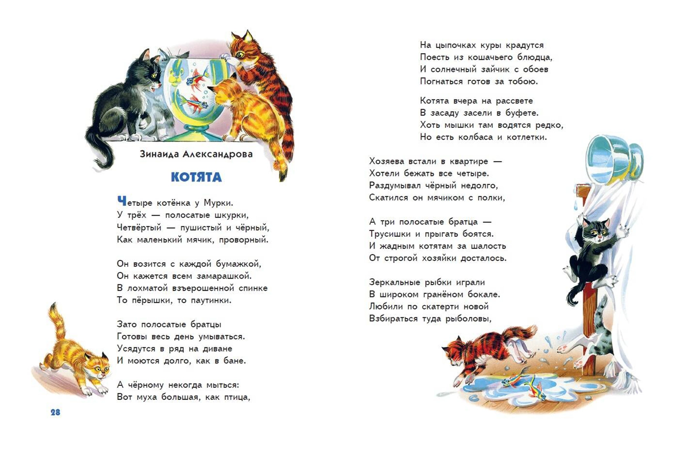
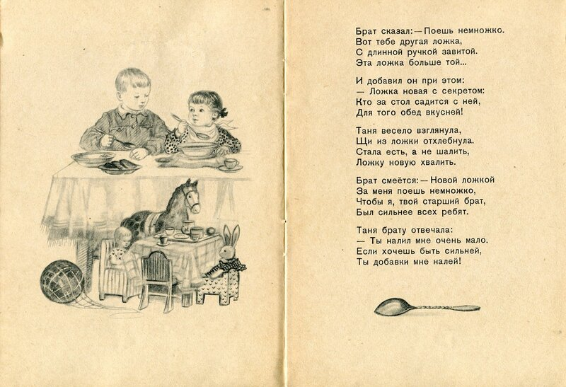

# PR #240: feat(vova): five lost Грёбаный бал songs, their albums, music unfurl

- **State:** open
- **URL:** https://github.com/vzakharov/vovazakharov.com/pull/240
- **Author:** @vzakharov (human)
- **Base ← Head:** main ← claude/horowo-song-mastering-oia0kq
- **Draft:** yes
- **Merged:** _not merged_
- **Created:** 2026-11-02T05:33:47Z
- **Updated:** 2026-11-02T06:42:51Z
- **Closed:** _not closed_
- **Labels:** _none_

---

## Awaiting an answer: 9

_Unresolved threads whose newest post is a human's, and human reviews and comments that are new since the last export or that no agent post has followed (no export committed on the branch yet). Resolved threads never count; an `(agent)` tail is a reply already given._

- **T01** `docs/remove-before-merging/horowo-song-mastering-oia0kq/lyrics/horowo.md`:17 — unresolved — last: @vzakharov (human) 2026-11-02T06:31:50Z — "отсылка к "Котятам" Александровой (строфа справа-вверху): <i…" → [↓](#t01)
- **T02** `docs/remove-before-merging/horowo-song-mastering-oia0kq/lyrics/horowo.md`:20 — unresolved — last: @vzakharov (human) 2026-11-02T06:32:55Z — "тоже Александрова, «Большая ложка» </a>

### Comment by @vzakharov (agent) on 2026-11-02T05:34:06Z

[https://github.com/vzakharov/vovazakharov.com/pull/240#issuecomment-6569907398](https://github.com/vzakharov/vovazakharov.com/pull/240#issuecomment-6569907398)

Proposed squash body:

```
Five Грёбаный бал songs that never reached the site — «Хорошо!»,
«За жизнь», «Последний снег», «Поздно» and «Незаметные штуки», the
last with words by Роман Попов — are published from their vovas-music
repositories, their words corrected from Suno prompts to what the
recordings sing. Each master was picked blind against Matchering
masters on /music/mastering-blind-test, which now plays any number of
masters per song: blind-abc.py builds and splits N, and each piece
states its own count.

The band's two albums take the operator's running order: Ни для кого
и для всех and Сильней любви are renumbered, the new songs placed on
them, and Доброе утро, За горизонт, Незаметные штуки and Призрачный
блюз stand as singles. «Сколько» becomes «Сколько нужно сделать»,
billed with за/обложкой. Every master whose album or title moved is
re-tagged in its repository.

Every song page declares itself in Open Graph's music vocabulary:
og:type music.song, og:audio pointing at the song's MP3, its duration,
album and musicians. A pasted link then plays where the messenger
honours og:audio (iMessage) and is typed as audio elsewhere. Telegram
embeds players only for allowlisted domains, so a page link does not
play inline there; the song's direct MP3 link does.

Co-authored-by: Claude <noreply@anthropic.com>
```

---

## Review threads

- **T01** `docs/remove-before-merging/horowo-song-mastering-oia0kq/lyrics/horowo.md`:17 — unresolved — last: @vzakharov (human) 2026-11-02T06:31:50Z — "отсылка к "Котятам" Александровой (строфа справа-вверху): <i…" → [↓](#t01)
- **T02** `docs/remove-before-merging/horowo-song-mastering-oia0kq/lyrics/horowo.md`:20 — unresolved — last: @vzakharov (human) 2026-11-02T06:32:55Z — "тоже Александрова, «Большая ложка» </a>

### `docs/remove-before-merging/horowo-song-mastering-oia0kq/lyrics/horowo.md`:17 — unresolved

```diff
@@ -0,0 +1,99 @@
… 12 lines elided …
+
+(Хорошо!) Когда просыпаешься ночью
+(Хорошо!) В поту прохладном и сочном
+(Хорошо!) И призрачный зайчик с обоев
+(Хорошо!) Погнаться готов за тобою
```

**@vzakharov (human)** — 2026-11-02T06:31:50Z

отсылка к "Котятам" Александровой (строфа справа-вверху):



---

<a id="t02"></a>

### `docs/remove-before-merging/horowo-song-mastering-oia0kq/lyrics/horowo.md`:20 — unresolved

```diff
@@ -0,0 +1,99 @@
… 16 lines elided …
+(Хорошо!) Погнаться готов за тобою
+
+(Хорошо!) Даже не в деревне летом[^village-ru]
+(Хорошо!) Ложка новая с секретом
```

**@vzakharov (human)** — 2026-11-02T06:32:55Z

тоже Александрова, «Большая ложка»



---

<a id="t03"></a>

### `docs/remove-before-merging/horowo-song-mastering-oia0kq/lyrics/horowo.md`:21 — unresolved

```diff
@@ -0,0 +1,99 @@
… 17 lines elided …
+
+(Хорошо!) Даже не в деревне летом[^village-ru]
+(Хорошо!) Ложка новая с секретом
+(Хорошо!) И все отступают напасти
```

**@vzakharov (human)** — 2026-11-02T06:34:20Z

отсылка к «Песенке про пустой горшок» из советского Винни-Пуха, хотя и не цитата (там «Конец твоим страданьям и разочарованьям, / И сразу наступает хорошая погода»

---

<a id="t04"></a>

### `docs/remove-before-merging/horowo-song-mastering-oia0kq/lyrics/horowo.md`:47 — unresolved

```diff
@@ -0,0 +1,99 @@
… 43 lines elided …
+
+Хорошо!
+
+[^village-ru]: Отсылка к присказке «Хорошо в деревне летом».
```

**@vzakharov (human)** — 2026-11-02T06:35:04Z

не к присказке, а к песне Сектора Газа :)

---

<a id="t05"></a>

### `docs/remove-before-merging/horowo-song-mastering-oia0kq/lyrics/horowo.md`:54 — unresolved

```diff
@@ -0,0 +1,99 @@
… 50 lines elided …
+If only I don’t drop dead from happiness
+In a serotonin-fall[^serotonin-en]
+There is one spell of foul weather here
+And that just for the rhyme
```

**@vzakharov (human)** — 2026-11-02T06:35:26Z

пояснить при чём тут "рифмы ради"

---

<a id="t06"></a>

### `docs/remove-before-merging/horowo-song-mastering-oia0kq/lyrics/horowo.md`:60 — unresolved

```diff
@@ -0,0 +1,99 @@
… 56 lines elided …
+Whatever anyone might think
+I’ll scratch out three words
+With a fingernail for a pencil
+How fucking good
```

**@vzakharov (human)** — 2026-11-02T06:35:50Z

как-то хлёстче можно придумать? давай варианты

---

<a id="t07"></a>

### `docs/remove-before-merging/horowo-song-mastering-oia0kq/lyrics/horowo.md`:12 — unresolved

```diff
@@ -0,0 +1,99 @@
… 8 lines elided …
+Кто б не подумал шо
+Я выскребу три слова
+Ногтём-карандашом
+Как сука хорошо
```

**@vzakharov (human)** — 2026-11-02T06:36:03Z

Тут кстати `, сука, `

---

<a id="t08"></a>

### `docs/remove-before-merging/horowo-song-mastering-oia0kq/squash-message.md`:4 — unresolved

```diff
@@ -0,0 +1,32 @@
+Proposed squash body:
+
+```
+Five Грёбаный бал songs that never reached the site — «Хорошо!»,
```

**@vzakharov (human)** — 2026-11-02T06:36:45Z

Хорошо -- новая, не потерянная

---

<a id="t09"></a>

### `docs/remove-before-merging/horowo-song-mastering-oia0kq/squash-message.md`:16 — unresolved

```diff
@@ -0,0 +1,32 @@
… 12 lines elided …
+The band's two albums take the operator's running order: Ни для кого
+и для всех and Сильней любви are renumbered, the new songs placed on
+them, and Доброе утро, За горизонт, Незаметные штуки and Призрачный
+блюз stand as singles. «Сколько» becomes «Сколько нужно сделать»,
```

**@vzakharov (human)** — 2026-11-02T06:37:21Z

я говорил, нужно сделать `feat. за/обложкой` :) название не меняется

---

## Timeline (status, references, and other events)

- **2026-11-02T05:34:10Z** @vzakharov renamed from «feat(vova): «Хорошо» — Грёбаный бал single, blind master test, music unfurl tags» to «feat(vova): «Хорошо», a blind master test, music unfurl tags».
- **2026-11-02T06:27:04Z** @vzakharov renamed from «feat(vova): «Хорошо», a blind master test, music unfurl tags» to «feat(vova): five lost Грёбаный бал songs, their albums, music unfurl».
- **2026-11-02T06:39:28Z** @vzakharov reviewed (COMMENTED): https://github.com/vzakharov/vovazakharov.com/pull/240#pullrequestreview-5732839721.
