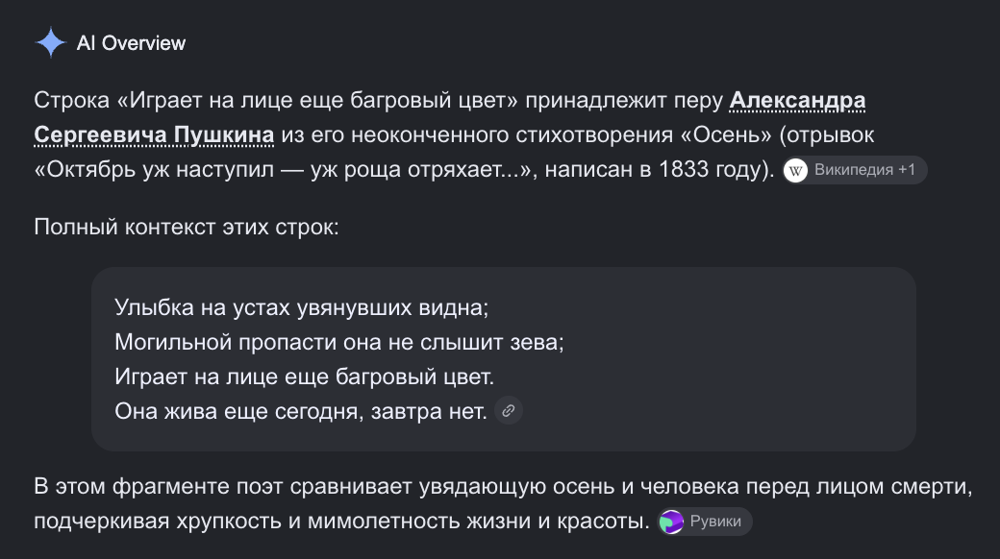

# PR #240: feat(vova): «Хорошо!» and four lost Грёбаный бал songs, their albums, music unfurl

- **State:** open
- **URL:** https://github.com/vzakharov/vovazakharov.com/pull/240
- **Author:** @vzakharov (human)
- **Base ← Head:** main ← claude/horowo-song-mastering-oia0kq
- **Draft:** yes
- **Merged:** _not merged_
- **Created:** 2026-11-02T05:33:47Z
- **Updated:** 2026-11-02T07:28:48Z
- **Closed:** _not closed_
- **Labels:** _none_

---

## Awaiting an answer: 5

_Unresolved threads whose newest post is a human's, and human reviews and comments that are new since the last export or that no agent post has followed (the export committed at 6a60023). Resolved threads never count; an `(agent)` tail is a reply already given._

- **T02** `docs/remove-before-merging/horowo-song-mastering-oia0kq/lyrics/talk-about-life.md`:9 — unresolved — last: @vzakharov (human) 2026-11-02T07:24:16Z — "может лучше на вторую строчку подсказку?" → [↓](#t02)
- **T03** `docs/remove-before-merging/horowo-song-mastering-oia0kq/lyrics/too-late.md`:4 — unresolved — last: @vzakharov (human) 2026-11-02T07:25:11Z — "отсылка к Библии -- "время сеять и время пожинать плоды"" → [↓](#t03)
- **T04** `docs/remove-before-merging/horowo-song-mastering-oia0kq/lyrics/too-late.md`:61 — unresolved — last: @vzakharov (human) 2026-11-02T07:26:37Z — "тут неточно передано "надышаться перед смертью" -- т.е. прот…" → [↓](#t04)
- **T05** `docs/remove-before-merging/horowo-song-mastering-oia0kq/lyrics/too-late.md`:29 — unresolved — last: @vzakharov (human) 2026-11-02T07:27:15Z — "отсылка к Пушкину </a>

### Comment by @vzakharov (agent) on 2026-11-02T05:34:06Z

[https://github.com/vzakharov/vovazakharov.com/pull/240#issuecomment-6569907398](https://github.com/vzakharov/vovazakharov.com/pull/240#issuecomment-6569907398)

Proposed squash body:

```
Грёбаный бал's new song «Хорошо!» and four that never reached the
site — «За жизнь», «Последний снег», «Поздно» and «Незаметные штуки»,
the last with words by Роман Попов — are published from their
vovas-music repositories, their words corrected from Suno prompts to
what the recordings sing. Each master was picked blind against Matchering
masters on /music/mastering-blind-test, which now plays any number of
masters per song: blind-abc.py builds and splits N, and each piece
states its own count.

The band's two albums take the operator's running order: Ни для кого
и для всех and Сильней любви are renumbered, the new songs placed on
them, and Доброе утро, За горизонт, Незаметные штуки and Призрачный
блюз stand as singles. «Сколько» is billed feat. за/обложкой. Every
master whose album or billing moved is re-tagged in its repository.

Every song page declares itself in Open Graph's music vocabulary:
og:type music.song, og:audio pointing at the song's MP3, its duration,
album and musicians. A pasted link then plays where the messenger
honours og:audio (iMessage) and is typed as audio elsewhere. Telegram
embeds players only for allowlisted domains, so a page link does not
play inline there; the song's direct MP3 link does.

Co-authored-by: Claude <noreply@anthropic.com>
```

---

## Review threads

_8 resolved threads omitted; re-run with `--include-resolved` to export them._

- **T01** `docs/remove-before-merging/horowo-song-mastering-oia0kq/lyrics/horowo.md`:21 — unresolved — last: @vzakharov (agent) 2026-11-02T06:47:25Z — "Сноска «Отсылка к «Песенке про пустой горшок» из советского…" → [↓](#t01)
- **T02** `docs/remove-before-merging/horowo-song-mastering-oia0kq/lyrics/talk-about-life.md`:9 — unresolved — last: @vzakharov (human) 2026-11-02T07:24:16Z — "может лучше на вторую строчку подсказку?" → [↓](#t02)
- **T03** `docs/remove-before-merging/horowo-song-mastering-oia0kq/lyrics/too-late.md`:4 — unresolved — last: @vzakharov (human) 2026-11-02T07:25:11Z — "отсылка к Библии -- "время сеять и время пожинать плоды"" → [↓](#t03)
- **T04** `docs/remove-before-merging/horowo-song-mastering-oia0kq/lyrics/too-late.md`:61 — unresolved — last: @vzakharov (human) 2026-11-02T07:26:37Z — "тут неточно передано "надышаться перед смертью" -- т.е. прот…" → [↓](#t04)
- **T05** `docs/remove-before-merging/horowo-song-mastering-oia0kq/lyrics/too-late.md`:29 — unresolved — last: @vzakharov (human) 2026-11-02T07:27:15Z — "отсылка к Пушкину </a>

### `docs/remove-before-merging/horowo-song-mastering-oia0kq/lyrics/horowo.md`:21 — unresolved

```diff
@@ -0,0 +1,99 @@
… 17 lines elided …
+
+(Хорошо!) Даже не в деревне летом[^village-ru]
+(Хорошо!) Ложка новая с секретом
+(Хорошо!) И все отступают напасти
```

**@vzakharov (human)** — 2026-11-02T06:34:20Z

отсылка к «Песенке про пустой горшок» из советского Винни-Пуха, хотя и не цитата (там «Конец твоим страданьям и разочарованьям, / И сразу наступает хорошая погода»

**@vzakharov (agent)** — 2026-11-02T06:47:25Z

Сноска «Отсылка к «Песенке про пустой горшок» из советского «Винни-Пуха»» с цитатой оттуда, в обеих колонках — 55b4d78

---

<a id="t02"></a>

### `docs/remove-before-merging/horowo-song-mastering-oia0kq/lyrics/talk-about-life.md`:9 — unresolved

```diff
@@ -0,0 +1,147 @@
… 4 lines elided …
+Такой мрак — не видно ног, не то что дороги
+Но вот факт: чем трудней идти, тем легче ложатся строки
+
+А интересно, так же было тошно Пушкину[^pushkin-ru]
+Что, не разменяв и сорока, полез под пушку?
```

**@vzakharov (human)** — 2026-11-02T07:24:16Z

может лучше на вторую строчку подсказку?

---

<a id="t03"></a>

### `docs/remove-before-merging/horowo-song-mastering-oia0kq/lyrics/too-late.md`:4 — unresolved

```diff
@@ -0,0 +1,81 @@
+<!-- lyrics:ru -->
+
+Послушай, мы же оба знали: этот день придёт
+И время пожинать плоды когда-нибудь настанет
```

**@vzakharov (human)** — 2026-11-02T07:25:11Z

отсылка к Библии -- "время сеять и время пожинать плоды"

---

<a id="t04"></a>

### `docs/remove-before-merging/horowo-song-mastering-oia0kq/lyrics/too-late.md`:61 — unresolved

```diff
@@ -0,0 +1,81 @@
… 57 lines elided …
+With a mother’s care the scaffold greets us
+Already the mummers and clowns are working up the crowd
+We look at each other: maybe this time we’ll get away with it
+Hand in hand, and a last breath before death[^nadyshatsya-en]
```

**@vzakharov (human)** — 2026-11-02T07:26:37Z

тут неточно передано "надышаться перед смертью" -- т.е. противопоставление пословице, в которой это невозможно

---

<a id="t05"></a>

### `docs/remove-before-merging/horowo-song-mastering-oia0kq/lyrics/too-late.md`:29 — unresolved

```diff
@@ -0,0 +1,81 @@
… 24 lines elided …
+Жизнь сквозь кожу не удержать
+Поздно, поздно, поздно
+
+Играет на лице ещё багряный свет
+И мы живём ещё сегодня
```

**@vzakharov (human)** — 2026-11-02T07:27:15Z

отсылка к Пушкину



---

<a id="t06"></a>

### `docs/remove-before-merging/horowo-song-mastering-oia0kq/lyrics/unnoticed-things.md`:27 — unresolved

```diff
@@ -0,0 +1,55 @@
… 23 lines elided …
+
+А у вас как... Уже прокачали свой кухонный интерьер?
+
+[^bomzh-ru]: «Бомж» — бесплатный звонок или сообщение с просьбой перезвонить, который оператор давал отправить с нулевого баланса.
```

**@vzakharov (human)** — 2026-11-02T07:28:17Z

интересно что, кажется, изначально "*с*кинуть бомжа" -- т.е. позвонить и скинуть; интересно как метаморфирует сленг

---

## Timeline (status, references, and other events)

- **2026-11-02T05:34:10Z** @vzakharov renamed from «feat(vova): «Хорошо» — Грёбаный бал single, blind master test, music unfurl tags» to «feat(vova): «Хорошо», a blind master test, music unfurl tags».
- **2026-11-02T06:27:04Z** @vzakharov renamed from «feat(vova): «Хорошо», a blind master test, music unfurl tags» to «feat(vova): five lost Грёбаный бал songs, their albums, music unfurl».
- **2026-11-02T06:39:28Z** @vzakharov reviewed (COMMENTED): https://github.com/vzakharov/vovazakharov.com/pull/240#pullrequestreview-5732839721.
- **2026-11-02T06:56:11Z** @vzakharov renamed from «feat(vova): five lost Грёбаный бал songs, their albums, music unfurl» to «feat(vova): «Хорошо!» and four lost Грёбаный бал songs, their albums, music unfurl».
- **2026-11-02T06:58:41Z** @vzakharov — _head_ref_force_pushed_
- **2026-11-02T07:28:48Z** @vzakharov reviewed (COMMENTED): https://github.com/vzakharov/vovazakharov.com/pull/240#pullrequestreview-5733211304.
