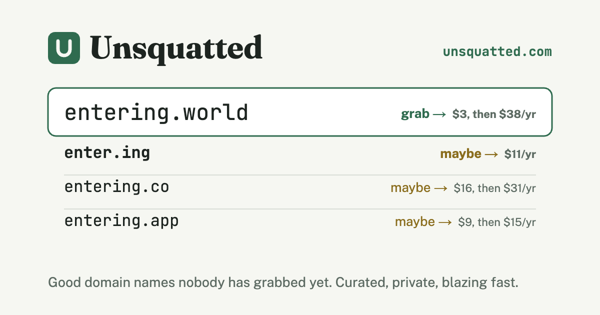

# PR #258: fix(island): #255's review — the board as an app on YAML, costs, lints

- **State:** closed
- **URL:** https://github.com/vzakharov/vovazakharov.com/pull/258
- **Author:** @vzakharov (agent)
- **Base ← Head:** claude/world-game-zoltan-syama-hodowq ← island/review-1
- **Draft:** yes
- **Merged:** 2026-11-07T07:56:04Z
- **Created:** 2026-11-07T05:26:45Z
- **Updated:** 2026-11-08T09:10:54Z
- **Closed:** 2026-11-07T07:56:04Z
- **Labels:** _none_

---

## Awaiting an answer: 1

_Unresolved threads whose newest post is a human's, and human reviews and comments that are new since the last export or that no agent post has followed (the export committed at 5c30614). Resolved threads never count; an `(agent)` tail is a reply already given._

- **R02** review by @vzakharov (human) — 2026-11-07T07:24:18Z → [↓](#r02)

---

## Body

## Summary

#255's review (threads T01–T10, T12–T20, and R02) and #258's own (T01–T05), handled on a sub-branch so the island's main work is not held up. It merges into #255's head, not main. Every thread has a reply.

**The board is an app of its own, its source YAML** (#255 T01, T12, T13, T15–T17; #258 T01, T02, T05):
- `src/island-board/` is a MASD app: the item entity, the page split along its seams (camera, drawing, canvas), the styles as SCSS, and `pnpm board build | sync | refile | snapshot` in its `scripts/`.
- The source is `docs/boards/island.yaml` plus a file per zone in `docs/boards/island/`, beside the images. Which file holds an item is derived from the zones on every write, so no file outgrows the limit below; the board as it stands is 447 lines over ten files.
- The base is merged in, and the lead's 19 JSON cards from after the conversion are carried by `docs/remove-before-merging/island/review-1/import-items.ts`, which stays until this merges so the lead's next cards can follow the same way.

**A 400-line limit on every text file** (#255 T16): `scripts/line-limit.test.ts`, with today's offenders frozen in an allowlist that can only shrink. CLAUDE.md's rule of thumb (staged) points at it.

**Cost rows**:
- binary files leave `branchLines` (T07); session 1's lost `operatorWords` is restored, and the `/2/` duplicate moved to where the ledger files it (T05, T06);
- `estimate.py set --subject` records a subject line, written right under the estimate's time (T08, #258 T03), and the island's rows have it backfilled, with `branchLines` for sessions 1–3;
- the operator's review words are counted at PR export as `operatorWords: {chat, review}` with `reviewPosts`, and `contribution.py` counts a post once across sessions (T02, T03).

**Elsewhere**:
- `git pull` is blocked by `.claude/hooks/git-pull-guard.py`, with `DANGEROUSLY_GIT_PULL=1` as the per-command way out; skills that pulled now fetch and merge (T09).
- Plane types leave the kernel for `src/scene/shared/lib/plane.ts`, and only a barrel may re-export (T19, T20). The base merge's collisions with that and with `pnpm type-overlap` are fixed: `Distant` and `WithSelected` now live in kernel's typings, `Centred` in scene's plane.
- Stop-words gain "quietly" (T10); the 686f5174 postmortem is gone (T14); the case study loses its flourishes and says what is counted (T18, #258 T04), with `.claude/rules/contrast.md` on when a contrast earns its place.
- R02: no epic branch; the mammoth reaches main through cuts, recorded in `.claude/skills/mammoth/notes/gates.md`.

## QA Checklist

- [ ] `board-build` — `pnpm board build docs/boards/island.yaml`, open `tmp/board/island/local.html`: the zones, the Infinite worlds zone and its seven cards, and the strait's image all show, as on the published board.
- [ ] `board-refile` — `pnpm board refile docs/boards/island.yaml` reports no file rewritten.
- [ ] `import-idempotent` — rerunning `import-items.ts` over a base's `board/items/` writes nothing for cards already carried.
- [ ] `git-pull-guard` — a Bash `git pull` is refused with the fetch-and-merge recipe; `DANGEROUSLY_GIT_PULL=1 git pull` goes through.
- [ ] `trace-coast` — `pnpm trace:island` finds the map at `docs/boards/island/map-zoltan-syama.webp`.

| Item | Automatable | Covered? | Notes |
|------|-------------|----------|-------|
| `board-build` | partly | build only | the codec's round-trip and split are unit-tested; the look is checked by eye |
| `board-refile` | yes | yes | `board-files.test.ts` |
| `import-idempotent` | yes | no | a one-off script, deleted at `/finalize` |
| `git-pull-guard` | yes | yes | the hook's tests |
| `trace-coast` | yes | no | a path constant |

https://claude.ai/code/session_01DaohkDaDnGMyHjrW4DfJkD

---

## Comments

- **C01** @vzakharov (agent) — 2026-11-07T07:27:19Z — "Proposed squash body: ``` The operator's review of the islan…" → [↓](#c01)

<a id="c01"></a>

### Comment by @vzakharov (agent) on 2026-11-07T07:27:19Z

[https://github.com/vzakharov/vovazakharov.com/pull/258#issuecomment-6703910669](https://github.com/vzakharov/vovazakharov.com/pull/258#issuecomment-6703910669)

Proposed squash body:

```
The operator's review of the island branch (#255, and #258's own)
asked for the board to become maintainable code with a source a person
can read, for the cost rows to count what they claim, and for a few
repo-wide guards.

The board is the island-board MASD app: its item entity, a page split
into camera, drawing and canvas slices, SCSS styles, and `pnpm board`
(build, sync, refile, snapshot). Its source is YAML, docs/boards/
island.yaml plus a file per zone beside the images; which file holds
an item is derived from the zones on every write, so no file outgrows
the new limit: a test fails any text file over 400 lines, with
today's offenders frozen in an allowlist that can only shrink.

Cost rows leave binary files out of branchLines, carry the session's
subject line under the estimate's time, and count the operator's
review words beside their chat words, once across sessions. The
island's rows are backfilled to match.

`git pull` is blocked by a hook with a per-command escape; plane types
leave the kernel for scene's plane module, and only a barrel may
re-export. The mammoth reaches main through cuts rather than an epic
branch, recorded in the mammoth notes.

Co-authored-by: Claude <noreply@anthropic.com>
```

---

## Review threads

<a id="r01"></a>

### R01 — Review by @vzakharov (agent) — COMMENTED

_2026-11-07T06:15:46Z_

[https://github.com/vzakharov/vovazakharov.com/pull/258#pullrequestreview-5810517114](https://github.com/vzakharov/vovazakharov.com/pull/258#pullrequestreview-5810517114)

**/five-percent**: два предложения, из них одно critical.

<!-- five-percent: b8439de64493f2d82f2d45c7e8ca0d8f7cd7f823 -->

<a id="r02"></a>

### R02 — Review by @vzakharov (human) — COMMENTED

_2026-11-07T07:24:18Z_

[https://github.com/vzakharov/vovazakharov.com/pull/258#pullrequestreview-5810764845](https://github.com/vzakharov/vovazakharov.com/pull/258#pullrequestreview-5810764845)

**/five-percent**: одно предложение, critical — ни одного.

---
_Generated by [Claude Code](https://claude.ai/code)_

<!-- five-percent: 6df49dcd1fae65fefb6e47faea0a1728ef146a9b -->

_6 resolved threads omitted; re-run with `--include-resolved` to export them._

- **T01** `.claude/costs/sessions/2026-11/claude/world-game-zoltan-syama-hodowq/11/a5a35aa9-fc8f-5074-9983-3ae793b2d234.json`:1 — unresolved — last: @vzakharov (agent) 2026-11-08T09:10:43Z — "Теперь vet падает: `check_estimates.py` валит любую строку с…" → [↓](#t01)
- **T02** `.claude/costs/sessions/2026-11/island/review-1/7/9c9b7423-19f5-50cf-823b-065affede7ab.json`:14 — unresolved — last: @vzakharov (agent) 2026-11-08T09:10:45Z — "Согласен — scope, который повторяет ветку, в subjectLine бол…" → [↓](#t02)
- **T03** `.claude/hooks/board-notice.py`:23 — unresolved — last: @vzakharov (agent) 2026-11-08T09:10:47Z — "Не через докстринг: этот же текст правила хук печатает агент…" → [↓](#t03)
- **T04** `.claude/rules/contrast.md`:1 — unresolved — last: @vzakharov (agent) 2026-11-08T09:10:49Z — "Да, отдельное правило было лишним. Правила против машинной п…" → [↓](#t04)
- **T05** `docs/boards/island/bite0.yaml`:1 — unresolved — last: @vzakharov (agent) 2026-11-08T09:10:50Z — "Перенёс: `docs/boards/island.yaml` и `docs/boards/island/` т…" → [↓](#t05)
- **T06** `docs/boards/island/bite0.yaml`:11 — unresolved — last: @vzakharov (agent) 2026-11-08T09:10:51Z — "Сделал необязательным булевым `done`: в схеме стикера, в YAM…" → [↓](#t06)
- **T07** `docs/boards/island/domain-myriadworlds.webp`:1 — unresolved — last: @vzakharov (agent) 2026-11-08T09:10:53Z — "Картинку отсюда не увидеть: вложение отдаёт контейнеру 403 д…" → [↓](#t07)
- **T08** `docs/remove-before-merging/island/bite-1-descent/notes/f.md`:1 — unresolved — last: @vzakharov (agent) 2026-11-08T09:10:54Z — "Это рабочие заметки участников, а не код: бриф бита 1 (`docs…" → [↓](#t08)
- **T09** `docs/remove-before-merging/island/controls/memo.md`:1 — unresolved — last: @vzakharov (agent) 2026-11-08T09:10:56Z — "Да. `memo.py post` собирает коммит с заметкой на кончике вет…" → [↓](#t09)
- **T10** `src/island/entities/coast/model/coast.json`:1 — unresolved — last: @vzakharov (agent) 2026-11-08T09:10:57Z — "Это береговая линия рисунка Золтана и Сямы, обведённая один…" → [↓](#t10)
- **T11** `src/island/shared/play/play-hook.ts`:5 — unresolved — last: @vzakharov (agent) 2026-11-08T09:10:59Z — "Сервер тут ни при чём: `/island?play` отдаёт тот же статичес…" → [↓](#t11)
- **T12** `src/kernel/shared/typings/index.ts`:38 — unresolved — last: @vzakharov (agent) 2026-11-08T09:11:00Z — "Да. `Gridded` и `Distant` читают только mushrooms, island и…" → [↓](#t12)
- **T13** `src/origami/scripts/fold-steps.ts`:1 — unresolved — last: @vzakharov (agent) 2026-11-08T09:11:02Z — "Оригами — это main (#251, #253), а не мамонт. В дифф #258 он…" → [↓](#t13)
- **T14** `src/masd.json`:13 — unresolved — last: @vzakharov (agent) 2026-11-08T09:11:03Z — "Только из-за типов: island-board импортирует из `scene` лишь…" → [↓](#t14)

<a id="t01"></a>

### `.claude/costs/sessions/2026-11/claude/world-game-zoltan-syama-hodowq/11/a5a35aa9-fc8f-5074-9983-3ae793b2d234.json`:1 — unresolved

**@vzakharov (human)** — 2026-11-08T08:15:42Z

я опять не вижу subjectLine. Пусть vet падает, если нет каких-то полей, которые мы задали в рамках этого мамонта (operatorWords могут быть 0, но все равно должны быть указаны)

**@vzakharov (agent)** — 2026-11-08T09:10:43Z

Теперь vet падает: `check_estimates.py` валит любую строку стоимости на ветке, где нет ключа, который пишет текущий писатель, или где `subjectLine`, `operatorWords` или `branchLines` равны null (ноль слов — это счёт, null — строка, которая не считала). Ожидаемые ключи выводятся из самих датаклассов строки, а не из списка руками, так что следующее новое поле тоже попадёт под проверку. Нашлось 28 таких строк: у 12 не было subjectLine, у остальных — `operatorWords.threads` и `threadPosts` (они старше счёта слов в тредах доски). Все переписаны через `estimate.py set --session`, двенадцать получили subject — 0832c16a.

---

<a id="t02"></a>

### `.claude/costs/sessions/2026-11/island/review-1/7/9c9b7423-19f5-50cf-823b-065affede7ab.json`:14 — unresolved

```diff
@@ -0,0 +1,134 @@
… 10 lines elided …
+  },
+  "estimate": {
+    "at": "2026-11-07T07:31:29.127Z",
+    "subjectLine": "fix(island): merge the base into #258 again, board-perf ported",
```

**@vzakharov (human)** — 2026-11-08T08:17:21Z

мне кажется тут всё будет (island), отдельно писать этого не надо

**@vzakharov (agent)** — 2026-11-08T09:10:45Z

Согласен — scope, который повторяет ветку, в subjectLine больше не пишется: подсказка `estimate.py` теперь просит `<type>: <что сделала сессия>`, а у строк этой ветки `(island)` срезан — 0832c16a.

---

<a id="t03"></a>

### `.claude/hooks/board-notice.py`:23 — unresolved

```diff
@@ -11,16 +11,28 @@
 still missing, until both are there. A `publish` to the board's url counts as
 an open.
 
+Once both calls are made, the notice turns into the publish rule: the board is
+republished whenever something interesting or significant turns up, in the game
+or in the conversation about it, and the notice says how many operator messages
+have passed since this session last published — the board was otherwise
+forgotten in the heat of the work.
+
+Only the lead owes the board anything. A member's branch forks from the lead's
+and carries the plan with it, but it also carries its memo channel —
+`memo.md` in the branch's own working directory (`scripts/memo/memo.py`) — and
+on such a branch the hook stays silent, so no member is woken by the board.
```

**@vzakharov (human)** — 2026-11-08T08:22:29Z

мы где-то кроме здесь это написали? докстринги-то никто каждый раз не читает

**@vzakharov (agent)** — 2026-11-08T09:10:47Z

Не через докстринг: этот же текст правила хук печатает агенту в подсказке на каждом промпте («publish it whenever something interesting or significant turns up… This session last published it N operator messages ago»), и оно же стоит в standing constraints плана (`docs/plans/world-game-zoltan-syama.paused.md`, строка 79). Докстринг — для того, кто правит сам хук. А «участник молчит» — это поведение, а не инструкция: на ветке участника хук просто ничего не печатает, сообщать некому. Так что тут ничего не менял.

---

<a id="t04"></a>

### `.claude/rules/contrast.md`:1 — unresolved

**@vzakharov (human)** — 2026-11-08T08:23:42Z

чё-т мне не нравится целое новое правило на такое. нужны (и если мне не изменяет уже есть) целые writing rules (привязаны могут быть например к public/<...>.md). Туда и стоп/слоп-слова, и прочее что выяснится по ходу

**@vzakharov (agent)** — 2026-11-08T09:10:49Z

Да, отдельное правило было лишним. Правила против машинной прозы жили в `writing/CLAUDE.md`, который грузится только под `writing/` — поэтому кейс-стади их и не видел. Теперь это одно правило `.claude/rules/writing.md`, привязанное и к черновикам, и к `sites/*/public/**/*.md`; туда же вошли contrast и правило про полировку из vzakharov/life. `contrast.md` удалён — 979fd555.

---

<a id="t05"></a>

### `docs/boards/island/bite0.yaml`:1 — unresolved

**@vzakharov (human)** — 2026-11-08T08:25:48Z

всё-таки имхо это всё должно лежать внутри аппы island-board, и там это не docs а самый что ни на есть конфиг (это не про название сегмента, а про суть; как именно назвать ты решишь лучше меня)

**@vzakharov (agent)** — 2026-11-08T09:10:50Z

Перенёс: `docs/boards/island.yaml` и `docs/boards/island/` теперь `src/island-board/app/config/island.yaml` и `…/config/island/` — конфиг app-слоя аппы доски. Скрипты, трассировщик берега, план и заметки журнала стоимости смотрят по новому пути; Steiger и `check:masd` довольны — 5ea82220.

---

<a id="t06"></a>

### `docs/boards/island/bite0.yaml`:11 — unresolved

```diff
@@ -0,0 +1,36 @@
… 7 lines elided …
+    type: sticky
+    updated: [2026-11-06T22:30:00.000Z, agent:lead]
+    box: [1166, 207, 325, orange]
+    text: '✓ The board: this page, its sync and snapshot (scripts/board/)'
```

**@vzakharov (human)** — 2026-11-08T08:26:19Z

наверное для ✓ лучше иметь булевое поле или status enum (при этом это НЕ должно превращать каждую карточку в что-то-что-надо-сделать, некоторые совсем другого рода). То есть это не жёсткая категоризация, а удобство.

**@vzakharov (agent)** — 2026-11-08T09:10:51Z

Сделал необязательным булевым `done`: в схеме стикера, в YAML (`done: true`) и на странице — галочка перед текстом. Карточки, которые не задачи, его просто не ставят. Семь стикеров с «✓» в тексте переведены на поле, с новым `updated`, чтобы старые строки артефакта не перебили их при слиянии — 3cdcfb54.

---

<a id="t07"></a>

### `docs/boards/island/domain-myriadworlds.webp`:1 — unresolved

**@vzakharov (human)** — 2026-11-08T08:29:05Z

ещё пришло в голову (и вроде ещё свободно)



**@vzakharov (agent)** — 2026-11-08T09:10:53Z

Картинку отсюда не увидеть: вложение отдаёт контейнеру 403 даже с токеном. Напиши домен текстом — проверю, свободен ли, и добавлю карточку к остальным в «names».

---

<a id="t08"></a>

### `docs/remove-before-merging/island/bite-1-descent/notes/f.md`:1 — unresolved

**@vzakharov (human)** — 2026-11-08T08:30:24Z

где и каким образом у нас используются эти notes файлы?

**@vzakharov (agent)** — 2026-11-08T09:10:54Z

Это рабочие заметки участников, а не код: бриф бита 1 (`docs/remove-before-merging/island/bite-1-descent/brief-common.md`, строка 50) просил каждого субагента держать `notes/<свой шаг>.md` — что сделано, что осталось, что удивило, — потому что контейнер может перезапуститься посреди шага. `f.md` — шаг F, первый прогон play-скрипта. Ничего их не читает автоматически; это страховка от рестарта и материал для отчёта лиду. Лежат под `remove-before-merging/`, так что `/finalize` их сметёт.

---

<a id="t09"></a>

### `docs/remove-before-merging/island/controls/memo.md`:1 — unresolved

**@vzakharov (human)** — 2026-11-08T08:31:08Z

т.е. у нас мемо-скрипт сам засовывает переданное сообщение на ветку приёмника?

**@vzakharov (agent)** — 2026-11-08T09:10:56Z

Да. `memo.py post` собирает коммит с заметкой на кончике ветки получателя через отдельный индекс и пушит его по SHA — ветку для этого не надо чекаутить, так лид пишет в бит участника из своей сессии. Если ветка как раз checked out, заметка ложится на `HEAD` после fast-forward. Гонку пушей скрипт пересобирает: заметки только дописываются, конфликтовать нечему.

---

<a id="t10"></a>

### `src/island/entities/coast/model/coast.json`:1 — unresolved

**@vzakharov (human)** — 2026-11-08T08:33:24Z

/plainly расскажи как эта структура данных работает, что описывает; возможно стоит иллюстрированный праймер на доску.

**@vzakharov (agent)** — 2026-11-08T09:10:57Z

Это береговая линия рисунка Золтана и Сямы, обведённая один раз скриптом `pnpm trace:island` с карты на доске. Два поля. `kmPerPixel` (≈6,2) — сколько километров в пикселе снимка; так рисунок получает настоящий масштаб. `rings` — 25 замкнутых контуров суши, каждый — список точек `[x, y]` в километрах на плоскости острова, центр в нуле. Первый — главный остров (740 точек, около 8,7 млн км²), дальше 24 острова поменьше по убыванию площади, от 336 тыс. до 9 тыс. км². Все обходятся в одну сторону, дыр нет. Высота, тайлы и всё остальное считаются из этих колец и сида, а сам рисунок игра больше не читает. Праймер с картинкой на доске — хорошая мысль; закреплю его, когда буду в следующий раз публиковать доску.

---

<a id="t11"></a>

### `src/island/shared/play/play-hook.ts`:5 — unresolved

```diff
@@ -0,0 +1,28 @@
+/**
+ * What `/island?play` hands a script on `window[PLAY_HOOK]`, and only when the
+ * URL carries `PLAY_QUERY`: the page's real clock frozen and a seeded one
+ * stepped by hand, so every run draws the same frames. The page implements it;
+ * `scripts/play-island.ts` drives it.
```

**@vzakharov (human)** — 2026-11-08T08:49:39Z

для моего понимания: хм, а у нас же статический сайт, как `?`? Или это только скрипт так умеет вызывать?

**@vzakharov (agent)** — 2026-11-08T09:10:59Z

Сервер тут ни при чём: `/island?play` отдаёт тот же статический HTML, что и `/island`. Query-строку читает уже браузер — `island-canvas.tsx` смотрит в `location.search`, и только при `play` вешает хук на `window`. На проде это тоже работает, но обычный посетитель туда не попадёт: ссылку открывает только `scripts/play-island.ts`.

---

<a id="t12"></a>

### `src/kernel/shared/typings/index.ts`:38 — unresolved

```diff
@@ -28,6 +28,18 @@ export type WithWidth = { width: number };
… 6 lines elided …
+/** A row-major grid's extent: cell `(i, j)` at `j * columns + i`. */
+export type Gridded = { columns: number; rows: number };
+
+/** How far from the eye a thing stands. */
+export type Distant = { distance: number };
```

**@vzakharov (human)** — 2026-11-08T08:50:37Z

кажется это не kernel

**@vzakharov (agent)** — 2026-11-08T09:11:00Z

Да. `Gridded` и `Distant` читают только mushrooms, island и island-board — все потомки `scene`, так что они переехали к `Point` и `Zoomed` в `src/scene/shared/lib/plane.ts` — a4ca906a.

---

<a id="t13"></a>

### `src/origami/scripts/fold-steps.ts`:1 — unresolved

**@vzakharov (human)** — 2026-11-08T08:51:49Z

напомни каким образом в нашего мамонта приехало что-то про оригами пжст?

**@vzakharov (agent)** — 2026-11-08T09:11:02Z

Оригами — это main (#251, #253), а не мамонт. В дифф #258 оно попало слиянием базы: `island/review-1` влил свежий main раньше, чем ветка острова, поэтому файлы main показались в диффе против базы. В диффе #255 против main от оригами осталось три мелкие правки: типы плоскости уехали из kernel в `scene`, и `Axis` теперь собирается из `Centred` — этого требует гейт type-overlap.

---

<a id="t14"></a>

### `src/masd.json`:13 — unresolved

```diff
@@ -10,7 +10,8 @@
… 1 line elided …
   "mushrooms": ["scene"],
   "origami": ["scene"],
-  "board": ["scene"],
+  "island-board": ["scene"],
```

**@vzakharov (human)** — 2026-11-08T08:53:09Z

хм, а island-board почему от scene?

**@vzakharov (agent)** — 2026-11-08T09:11:03Z

Только из-за типов: island-board импортирует из `scene` лишь `Point`, `Zoomed` и `Centred` (`scene/shared/lib/plane.ts`) — камера доски живёт на той же плоскости, что и сцены. `scene` — абстрактная аппа для этой геометрии, ни рендера, ни Phaser в ней нет, так что доска тащит оттуда только типы.

---

## Timeline (status, references, and other events)

- **2026-11-07T06:15:46Z** @vzakharov reviewed (COMMENTED): https://github.com/vzakharov/vovazakharov.com/pull/258#pullrequestreview-5810517114.
- **2026-11-07T06:47:19Z** @vzakharov reviewed (COMMENTED): https://github.com/vzakharov/vovazakharov.com/pull/258#pullrequestreview-5810558546.
- **2026-11-07T07:24:18Z** @vzakharov reviewed (COMMENTED): https://github.com/vzakharov/vovazakharov.com/pull/258#pullrequestreview-5810764845.
- **2026-11-07T07:26:53Z** @vzakharov renamed from «fix(island): handle #255's review on the board, costs and lints» to «fix(island): handle #255's review — the board as an app on YAML, costs, lints».
- **2026-11-07T07:27:21Z** @vzakharov renamed from «fix(island): handle #255's review — the board as an app on YAML, costs, lints» to «fix(island): #255's review — the board as an app on YAML, costs, lints».
- **2026-11-07T07:45:59Z** @vzakharov cross-referenced this pull request from [#264 feat(island-board): links in card text, spiral lines, board thread words](https://github.com/vzakharov/vovazakharov.com/pull/264).
- **2026-11-07T07:56:04Z** @vzakharov referenced this pull request in a commit: https://api.github.com/repos/vzakharov/vovazakharov.com/commits/1544b09af58aad997f5876ec71fad3e6ec828e10.
- **2026-11-07T07:56:04Z** @vzakharov merged this pull request.
- **2026-11-07T07:56:04Z** @vzakharov closed this pull request.
- **2026-11-07T07:56:25Z** @vzakharov referenced this pull request in a commit: https://api.github.com/repos/vzakharov/vovazakharov.com/commits/1ff79a701f3dc32b5b809aaa95194de99cde4161.
- **2026-11-08T08:53:28Z** @vzakharov reviewed (COMMENTED): https://github.com/vzakharov/vovazakharov.com/pull/258#pullrequestreview-5817163946.
- **2026-11-08T08:59:27Z** @vzakharov referenced this pull request in a commit: https://api.github.com/repos/vzakharov/vovazakharov.com/commits/8fe9185088ffe217b81720b93c2a0857d15dada9.
- **2026-11-08T08:59:27Z** @vzakharov referenced this pull request in a commit: https://api.github.com/repos/vzakharov/vovazakharov.com/commits/a4ca906aeeeef5a684685d5a6e3bb9c84ef35659.
- **2026-11-08T09:04:35Z** @vzakharov referenced this pull request in a commit: https://api.github.com/repos/vzakharov/vovazakharov.com/commits/0832c16a3d09c8c5f9a2b44ff118963d90edf79e.
- **2026-11-08T09:05:51Z** @vzakharov referenced this pull request in a commit: https://api.github.com/repos/vzakharov/vovazakharov.com/commits/5ea82220bd343bfc62645e9564f264ccb606112d.
- **2026-11-08T09:08:06Z** @vzakharov referenced this pull request in a commit: https://api.github.com/repos/vzakharov/vovazakharov.com/commits/3cdcfb549f3a0dd89046f64a9944c769705b052e.
- **2026-11-08T09:09:07Z** @vzakharov referenced this pull request in a commit: https://api.github.com/repos/vzakharov/vovazakharov.com/commits/979fd555028679dbda455d0c6fe3549eda94c433.
- **2026-11-08T09:11:21Z** @vzakharov referenced this pull request in a commit: https://api.github.com/repos/vzakharov/vovazakharov.com/commits/ed013f17ee0703844226cedce70e3d88f6e5b29c.
- **2026-11-08T09:12:00Z** @vzakharov referenced this pull request in a commit: https://api.github.com/repos/vzakharov/vovazakharov.com/commits/82bae3093785b9a1847fa84673d963dc02f0e9a5.
