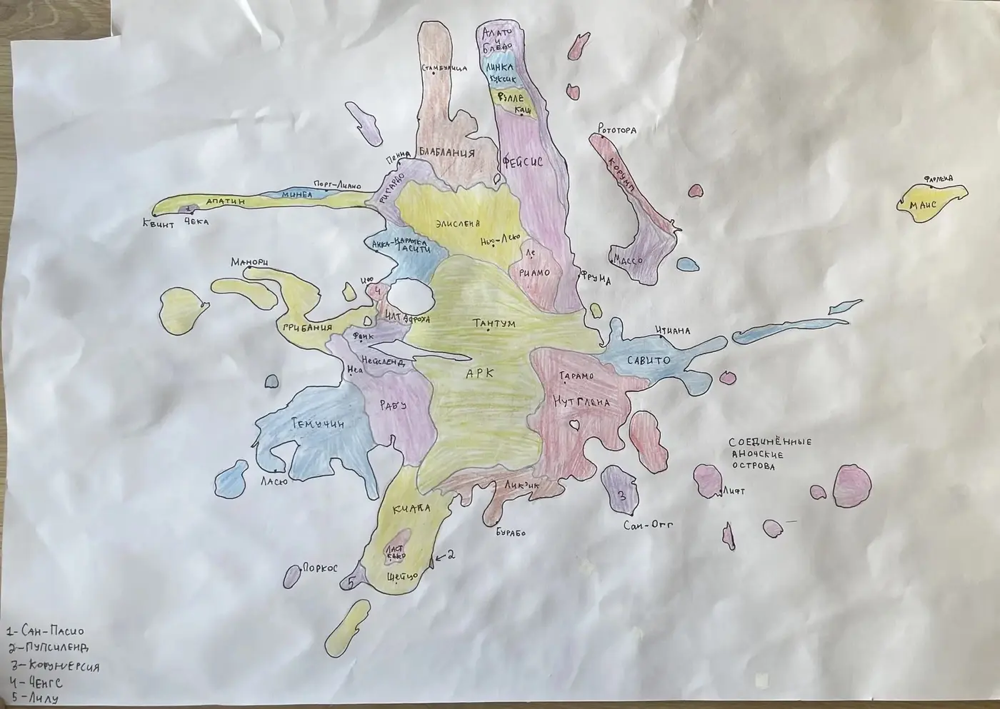
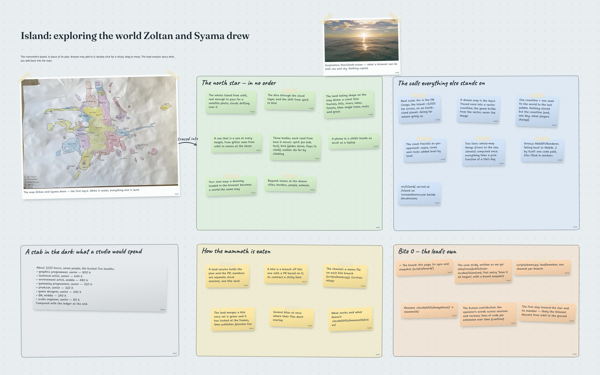

# Island: a game built on a hand-drawn map

This case study is written while the game is being built, not after. Experience says that writing such things in hindsight goes very, very slowly — so each entry below is dated, and each comes with a snapshot of the plan as it stood that day.

## 6 November 2026 — how it all began

About a month after the mushrooms, it felt like time for something new and big.

Zoltan and Syama once drew a map: a large island, its countries colored in, its cities and seas named, a scatter of smaller islands around it.

I wanted a game based on it — just an exploration game for now.

### The descent

Picture this. First you see the whole island from almost-space. Clouds drift across it here and there, so it isn’t a “Google Maps” view but something close to real.

You go down. Up to a certain point you’re an indefinite, bodiless creature that can move — zoom in — very fast. As you near bird’s-eye height, roughly when you pass through the cloud layer, you become a bird gliding over it all. The land comes closer and closer and starts to take shape. When you’re close, rivers become rivers, hills become hills, trees become trees. No towns, people or animals yet — that comes later. For now it is an untouched world to explore. And right by the ground, you start to walk.

You never see yourself, but you can guess what you are from how you move: no bobbing at the top; small rises and falls as a bird, gliding down along a natural path unless you flap; and walking once you walk.

The world can’t be generated all at once, of course, only as you approach: what is visible from a given height, at the moment it becomes visible; where exactly each tree stands, once you’re close enough to see it.

So that nobody (the agent included) thought this was out of reach, I pointed at a small repo, [web-ocean](https://github.com/Noniv/web-ocean) — a browser drawing sea and sky well enough to stop you scrolling. Not to borrow from; just proof that it can be done.

### What we settled before writing any code

- **The scale is real.** Arc, the biggest country on the map, is about the size of the DR Congo, which makes the island some 5,000 km across, on an Earth-sized planet. Getting somewhere far means going up: climb above the clouds, and the higher you are, the faster you travel.
- **A drawing is the input.** Not this drawing in particular — any child’s map. White is water, everything else is land; the map is traced once into a vector coastline, and the game builds from that vector, never from the JPEG. Which leaves the door open for anyone to load their own drawing one day. The coast is never perfectly smooth: it fractals as you approach.
- **One coastline and one number fix the whole world, down to the last pebble.** I had assumed the map would have to be stored somehow; it turns out only the coastline is, and everything else — rivers, climate, every tree — is computed from it and a seed, the same way every time. What has to agree across the whole map (rivers running to the sea, climate) is computed once; everything finer is a function of the patch of ground you’re looking at.
- **A north star instead of a schedule.** The first draft of the plan laid the work out in waves. I asked for the opposite: a star we walk toward, learning on the way that what looked very hard turned out simple, and the other way round. The star is a list in no order — the island from orbit, the dive through the clouds, the land taking shape, a sea that is a sea at every height, three bodies, a phone in a child’s hands, your own map, and beyond.

### The mammoth

The mushrooms were built as an “elephant” — a big job eaten one bite at a time, each bite a session of its own. This one is bigger, so it’s a mammoth: an elephant eaten by a team. A lead session holds the plan and the pull request; members are separate cloud sessions, one bite each, each on its own branch; the lead merges a bite once the checks are green and it has looked at what the bite draws.

### The board instead of the plan

Then I asked for something unusual. Instead of a plan file, the plan is an infinite board — stickies, lines where they help, pictures pinned for inspiration and for checking — that any session can draw on, and so can I. It’s stored in the repo, so it can be rebuilt from any account, and published as a page where my edits sync back.

The first version came out too tidy — a ledger, not a table someone had drawn on. So now every sticky is tilted a little, by an amount derived from its name so it never jumps between renders; half of them are taped on; the lines are bowed pencil strokes with handwritten labels. This is the board on the evening the work began:

### Keeping score

Two things will be measured, so that at the end we know what this actually took.

**What a human put in.** My own words, across every session’s messages and every code review, and lines of code per file type over time, as a cumulative-flow chart. Both are read off the record — the session transcripts, the pull requests, the git history — rather than counted as we go.

**What a studio would have spent.** A stab in the dark, made on day one and kept here unchanged to compare with what the work actually adds up to:

| Role                        | Hours     |
| --------------------------- | --------- |
| Graphics programmer, senior | 800       |
| Technical artist, senior    | 640       |
| Environment artist, middle  | 480       |
| Gameplay programmer, senior | 320       |
| Producer, senior            | 320       |
| Game designer, senior       | 240       |
| QA, middle                  | 240       |
| Audio engineer, senior      | 80        |
| **Total**                   | **3,120** |

About seven people, busiest for five months.
